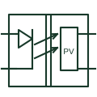

# Photovoltaic MOSFET driver

An optical component producing an isolated photovoltaic output used to drive a MOSFET gate circuit.

[Canonical reference](https://eloragrid.ai/symbols/photovoltaic-mosfet-driver) · [Structured record](../entries/photovoltaic-mosfet-driver.json) · [All references](README.md)

Updated: 2026-10-27. Drawing use: Schematic. Reference families: Manufacturer.

## What it represents

An optical component producing an isolated photovoltaic output used to drive a MOSFET gate circuit.
On a schematic, identify the LED input, photovoltaic output polarity and gate-discharge arrangement and trace the isolated MOSFET switching circuit. Keep the component tag and signal/reference names consistent across the control drawing, terminal schedule and device documentation.
The photovoltaic output drives a gate circuit; this component is distinct from a solar-generator power connection.
The preview is an independently drawn educational functional reference. Add the selected component’s actual power pins, terminal numbers, timing or analogue reference details when producing a construction drawing.

## How to read it

- Identify the LED input, photovoltaic output polarity and gate-discharge arrangement.
- Trace the isolated MOSFET switching circuit.

## Drawing checklist

- Label the LED input, photovoltaic output polarity and gate-discharge arrangement.
- Cross-reference the isolated MOSFET switching circuit.
- Add the selected device or circuit documentation revision, power/reference connections and project signal convention.

## Important distinction

The photovoltaic output drives a gate circuit; this component is distinct from a solar-generator power connection.

## Facts

- Common schematic mnemonic: PV-DRV — descriptive only; project/device documentation defines reference designations.
- Terminal / interface focus: The LED input, photovoltaic output polarity and gate-discharge arrangement
- Artwork scope: Original educational functional/circuit reference; not a selected product pinout.

## Public references

- [VOM1271 photovoltaic MOSFET driver documentation](https://www.vishay.com/docs/83469/vom1271.pdf) — Vishay. Public primary manufacturer documentation establishes the component function or circuit/topology relationship. Preview geometry and drafting explanations are independently authored.

## Related references

- [N-channel enhancement MOSFET](n-channel-enhancement-mosfet.md)
- [Diode](diode.md)

Original educational concept geometry, CC BY 4.0. Unitless; not a certified standards glyph or manufacturer footprint.

Elora-authored explanations are CC BY 4.0. Linked standards and manufacturer material retain their own rights. Confirm project requirements using primary sources.
