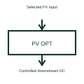

# Photovoltaic power optimiser

A solar power optimiser uses conversion and control at a selected module or input level.

[Canonical reference](https://eloragrid.ai/symbols/photovoltaic-power-optimiser) · [Structured record](../entries/photovoltaic-power-optimiser.json) · [All references](README.md)

Updated: 2026-10-27. Drawing use: Schematic. Reference families: Manufacturer.

## What it represents

A solar power optimiser uses conversion and control at a selected module or input level.
A module-level optimiser can adjust its operating point within the chosen solar architecture.
Locate the optimiser between its selected solar input and downstream DC arrangement. It uses conversion and control near the module or input it serves. Show the downstream inverter as a separate function unless the selected equipment documentation explicitly combines the roles. This is original functional artwork, not a certified standard graphic or device pinout.

## How to read it

- Identify the module or input served by the optimiser.
- Reference the supported downstream equipment and communication.
- Show the selected input/output polarity and installation arrangement.
- An optimiser is not necessarily the equipment producing the final AC connection.

## Drawing checklist

- Identify the module or input served by the optimiser.
- Reference the supported downstream equipment and communication.
- Show the selected input/output polarity and installation arrangement.

## Important distinction

An optimiser is not necessarily the equipment producing the final AC connection.

## Facts

- Representation type: Original functional block; not a certified IEC or IEEE graphic
- Concept input: Selected PV input
- Concept output: Controlled downstream DC

## Public references

- [Solar power optimiser architecture](https://www.ti.com/solution/solar-power-optimizer) — Texas Instruments. Solar power optimiser architecture: public technical context for the named function. Product and compliance details remain with the publisher.

## Related references

- [Photovoltaic inverter](photovoltaic-inverter.md)
- [Power converter / inverter](power-converter.md)
- [Terminal connection](terminal.md)

Original educational concept geometry, CC BY 4.0. Unitless; not a certified standards glyph or manufacturer footprint.

Elora-authored explanations are CC BY 4.0. Linked standards and manufacturer material retain their own rights. Confirm project requirements using primary sources.
