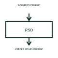

# Photovoltaic rapid shutdown function

Rapid shutdown is a defined solar-system function that changes specified circuit conditions following a shutdown command.

[Canonical reference](https://eloragrid.ai/symbols/photovoltaic-rapid-shutdown) · [Structured record](../entries/photovoltaic-rapid-shutdown.json) · [All references](README.md)

Updated: 2026-10-27. Drawing use: Schematic. Reference families: Manufacturer.

## What it represents

Rapid shutdown is a defined solar-system function that changes specified circuit conditions following a shutdown command.
A shutdown controller and field devices can form the selected shutdown arrangement.
Identify the initiating command, controlled equipment and the circuit boundary to which the shutdown action applies. This makes the intended action understandable without inventing a shutdown time or compliance claim. The selected system documentation establishes those requirements and how the devices achieve them. This is original functional artwork, not a certified standard graphic or device pinout.

## How to read it

- Show the initiating command and controlled devices.
- Identify the relevant circuit boundary.
- Reference the selected shutdown behaviour and applicable installation requirements.
- The functional block does not assert compliance, shutdown boundaries or a particular operating time.

## Drawing checklist

- Show the initiating command and controlled devices.
- Identify the relevant circuit boundary.
- Reference the selected shutdown behaviour and applicable installation requirements.

## Important distinction

The functional block does not assert compliance, shutdown boundaries or a particular operating time.

## Facts

- Representation type: Original functional block; not a certified IEC or IEEE graphic
- Concept input: Shutdown initiation
- Concept output: Defined circuit condition

## Public references

- [Solar rapid shutdown function](https://www.ti.com/solution/rapid-shutdown) — Texas Instruments. Solar rapid shutdown function: public technical context for the named function. Product and compliance details remain with the publisher.

## Related references

- [Photovoltaic inverter](photovoltaic-inverter.md)
- [Power converter / inverter](power-converter.md)
- [Terminal connection](terminal.md)

Original educational concept geometry, CC BY 4.0. Unitless; not a certified standards glyph or manufacturer footprint.

Elora-authored explanations are CC BY 4.0. Linked standards and manufacturer material retain their own rights. Confirm project requirements using primary sources.
