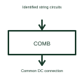

# Photovoltaic string combiner

A string combiner brings identified solar DC circuits together at a defined connection arrangement.

[Canonical reference](https://eloragrid.ai/symbols/photovoltaic-string-combiner) · [Structured record](../entries/photovoltaic-string-combiner.json) · [All references](README.md)

Updated: 2026-10-27. Drawing use: Schematic. Reference families: Manufacturer.

## What it represents

A string combiner brings identified solar DC circuits together at a defined connection arrangement.
Several string connections can feed a common outgoing DC route through their selected protection and monitoring.
Show each incoming string and the common outgoing DC connection, including any separately specified protection, isolation and monitoring. A combiner is a junction arrangement; its name alone does not establish which protective devices are installed or which string combinations are permitted. This is original functional artwork, not a certified standard graphic or device pinout.

## How to read it

- Label every incoming string and the common outgoing circuit.
- Identify installed protection and isolation separately.
- Reference the selected enclosure, terminals and monitoring documents.
- A combining connection does not replace the need to specify each circuit's protection and isolation.

## Drawing checklist

- Label every incoming string and the common outgoing circuit.
- Identify installed protection and isolation separately.
- Reference the selected enclosure, terminals and monitoring documents.

## Important distinction

A combining connection does not replace the need to specify each circuit's protection and isolation.

## Facts

- Representation type: Original functional block; not a certified IEC or IEEE graphic
- Concept input: Identified string circuits
- Concept output: Common DC connection

## Public references

- [Solar string combiner functions](https://www.ti.com/solution/smart-combiner-box) — Texas Instruments. Solar string combiner functions: public technical context for the named function. Product and compliance details remain with the publisher.

## Related references

- [Photovoltaic generator](photovoltaic-generator.md)
- [Power converter / inverter](power-converter.md)
- [Terminal connection](terminal.md)

Original educational concept geometry, CC BY 4.0. Unitless; not a certified standards glyph or manufacturer footprint.

Elora-authored explanations are CC BY 4.0. Linked standards and manufacturer material retain their own rights. Confirm project requirements using primary sources.
