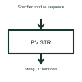

# Photovoltaic string

A photovoltaic string is a defined series-connected group of modules.

[Canonical reference](https://eloragrid.ai/symbols/photovoltaic-string) · [Structured record](../entries/photovoltaic-string.json) · [All references](README.md)

Updated: 2026-10-27. Drawing use: Schematic. Reference families: Manufacturer.

## What it represents

A photovoltaic string is a defined series-connected group of modules.
A solar drawing can identify each string before it reaches a combiner or inverter input.
Identify the modules connected in series and label the string’s ends. A string is a connection arrangement, not a particular module product. The module choice and number in series determine the conditions that must be checked against the connected equipment and installation requirements. This is original functional artwork, not a certified standard graphic or device pinout.

## How to read it

- State module type and number in series.
- Identify the string’s positive and negative connections.
- Cross-reference the selected combiner, isolation and receiving equipment.
- The number and type of modules determine string conditions; the label alone does not.

## Drawing checklist

- State module type and number in series.
- Identify the string’s positive and negative connections.
- Cross-reference the selected combiner, isolation and receiving equipment.

## Important distinction

The number and type of modules determine string conditions; the label alone does not.

## Facts

- Representation type: Original functional block; not a certified IEC or IEEE graphic
- Concept input: Specified module sequence
- Concept output: String DC terminals

## Public references

- [Solar electrical system architecture](https://www.ti.com/applications/industrial/energy-infrastructure/solar-energy/overview.html) — Texas Instruments. Solar electrical system architecture: public technical context for the named function. Product and compliance details remain with the publisher.

## Related references

- [Photovoltaic generator](photovoltaic-generator.md)
- [Photovoltaic module](photovoltaic-module.md)
- [Power converter / inverter](power-converter.md)
- [Terminal connection](terminal.md)

Original educational concept geometry, CC BY 4.0. Unitless; not a certified standards glyph or manufacturer footprint.

Elora-authored explanations are CC BY 4.0. Linked standards and manufacturer material retain their own rights. Confirm project requirements using primary sources.
