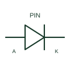

# PIN diode

A diode structure used in applications such as RF switching or attenuation with a documented bias circuit.

[Canonical reference](https://eloragrid.ai/symbols/pin-diode) · [Structured record](../entries/pin-diode.json) · [All references](README.md)

Updated: 2026-10-27. Drawing use: Schematic. Reference families: Manufacturer.

## What it represents

A diode structure used in applications such as RF switching or attenuation with a documented bias circuit.
On a schematic, identify the anode/cathode connection and DC bias path and trace the RF signal route and isolation components. Keep the component tag and signal/reference names consistent across the control drawing, terminal schedule and device documentation.
The letters PIN describe the semiconductor structure and do not mean a connector pin or digital input.
Terminal letters describe electrical roles, not package pin numbers. Check the selected public datasheet for the actual pin assignment, polarity and any internally connected terminals before completing the drawing.

## How to read it

- Identify the anode/cathode connection and DC bias path.
- Trace the RF signal route and isolation components.

## Drawing checklist

- Label the anode/cathode connection and DC bias path.
- Cross-reference the RF signal route and isolation components.
- Add the selected device or circuit documentation revision, power/reference connections and project signal convention.

## Important distinction

The letters PIN describe the semiconductor structure and do not mean a connector pin or digital input.

## Facts

- Common schematic mnemonic: PIN — descriptive only; project/device documentation defines reference designations.
- Terminal / interface focus: The anode/cathode connection and DC bias path
- Artwork scope: Original educational component glyph; not a certified standard graphic or package pinout.

## Public references

- [BAP64-02 silicon PIN diode documentation](https://www.nxp.com/docs/en/data-sheet/BAP64-02.pdf) — NXP Semiconductors. Public primary manufacturer documentation establishes the component function or circuit/topology relationship. Preview geometry and drafting explanations are independently authored.

## Related references

- [Diode](diode.md)
- [Power converter / inverter](power-converter.md)

Original educational concept geometry, CC BY 4.0. Unitless; not a certified standards glyph or manufacturer footprint.

Elora-authored explanations are CC BY 4.0. Linked standards and manufacturer material retain their own rights. Confirm project requirements using primary sources.
