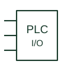

# PLC input / output

A controller interface point connecting field signals to an identified module channel.

[Canonical reference](https://eloragrid.ai/symbols/plc-io) · [Structured record](../entries/plc-io.json) · [All references](README.md)

Updated: 2026-10-27. Drawing use: Schematic. Reference families: IEC, IEEE / ANSI.

## What it represents

A PLC input or output point connects a field signal with a controller module and channel. Input and output, digital and analogue, and one-wire or multi-wire arrangements are distinct characteristics. The module specification establishes electrical behaviour and terminal information.
A schematic should connect channel identification to the I/O schedule and field device. Shared supplies, commons and isolation boundaries require their own documentation. A generic controller box is not a pinout or wiring instruction for a particular module.

## How to read it

- Identify module, channel and signal direction.
- Use the selected module documentation to interpret supply, common and terminal requirements.

## Drawing checklist

- Match the I/O schedule.
- Identify signal type and channel reference.
- Link module terminals and field-device documentation.

## Important distinction

An input point, output point and communications connection are different interfaces. A generic box cannot establish their electrical compatibility.

## Facts

- Channel identity: Controller, module and point
- Signal characteristics: Selected module specification
- Interface direction: Input or output
- Public Autodesk reference names: PLCIOI1T, PLCIOO1T (vendor identifiers, not IEC symbol IDs)

## Public references

- [PLC input and output point symbols](https://help.autodesk.com/cloudhelp/2021/ENU/AutoCAD-Electrical/files/GUID-16A484BE-F73C-4612-8D12-E760E981C4E9.htm) — Autodesk. Public input/output point and wiring-count categories.

## Related references

- [Terminal connection](terminal.md)
- [Indicator lamp](indicator-lamp.md)
- [Selector switch](selector-switch.md)
- [Control / marshalling cabinet](control-cabinet.md)

Original educational concept geometry, CC BY 4.0. Unitless; not a certified standards glyph or manufacturer footprint.

Elora-authored explanations are CC BY 4.0. Linked standards and manufacturer material retain their own rights. Confirm project requirements using primary sources.
