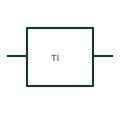

# PLC temperature input

A PLC temperature input connects a documented RTD, thermocouple or compatible sensor through the selected module.

[Canonical reference](https://eloragrid.ai/symbols/plc-temperature-input) · [Structured record](../entries/plc-temperature-input.json) · [All references](README.md)

Updated: 2026-10-27. Drawing use: Schematic. Reference families: Manufacturer.

## What it represents

A PLC temperature input connects a documented RTD, thermocouple or compatible sensor through the selected module. Sensor type and conductor count determine its wiring and configuration.

## How to read it

- Preserve thermocouple polarity or RTD lead arrangement in the schematic.
- The preview is an original explanation of this function. Match the actual drawing convention to its legend and the selected equipment documentation.

## Drawing checklist

- State sensor type
- Show conductor/polarity arrangement
- Reference channel scaling

## Important distinction

A dedicated temperature input is different from an analog input receiving a conditioned transmitter signal.

## Facts

- Drawing role: Controller interface
- Representation scope: Functional concept; not an official standard graphic or a product footprint
- Identifier status: The short label is a functional lookup label, not an assigned IEC or IEEE symbol number. Any separately listed Autodesk code is a verified vendor block name.

## Public references

- [Modicon TM3 analog I/O hardware guide](https://www.se.com/us/en/download/document/EIO0000003131/) — Schneider Electric. Public documentation of this equipment function or named vendor variant; the illustration is independently authored and is not the source graphic.

## Related references

- [PLC input / output](plc-io.md)
- [Terminal connection](terminal.md)

Original educational concept geometry, CC BY 4.0. Unitless; not a certified standards glyph or manufacturer footprint.

Elora-authored explanations are CC BY 4.0. Linked standards and manufacturer material retain their own rights. Confirm project requirements using primary sources.
