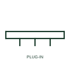

# Plug-in busway

Busway with tap-off outlets along its length, drawn with outlet marks where plug-in units can be connected.

[Canonical reference](https://eloragrid.ai/symbols/plug-in-busway) · [Structured record](../entries/plug-in-busway.json) · [All references](README.md)

Updated: 2026-10-28. Drawing use: SLD, GA. Reference families: IEC, IEEE / ANSI, Manufacturer.

## What it represents

Plug-in busway distributes power along its route through outlets into which tap-off units can be inserted. It is common in rising mains in multi-storey buildings, factory floors and data halls, where loads change and new feeders are added without rewiring.
The symbol shows that outlets exist but not which are used. Tap-off units actually fitted are drawn separately with their protective devices. Readers should not assume every outlet mark represents a connected load, and voltage drop calculations should use the actual tap-off positions.

## How to read it

- Distinguish outlet positions from fitted tap-off units.
- Check voltage drop to the most remote tap-off.

## Drawing checklist

- Mark outlet positions on the layout.
- Draw fitted tap-off units separately.
- State rating and conductor configuration.

## Important distinction

Plug-in busway has outlets for tap-off units; feeder busway carries power point to point only.

## Facts

- Graphic cue: Busway line with outlet marks along it
- Typical use: Rising mains and flexible factory distribution
- Preview: Original educational illustration; consult the publisher and applicable standard for the exact graphic

## Public references

- [Canalis busbar trunking systems](https://www.se.com/ww/en/work/products/master-ranges/line-series/) — Schneider Electric. Manufacturer busbar trunking ranges with tap-off outlets.
- [Electrical installation design methodology and references](https://www.electrical-installation.org/enwiki/General_rules_of_electrical_installation_design) — Schneider Electric — Electrical Installation Guide. Installation design methodology including busway distribution.

## Related references

- [Feeder busway](busway-feeder-run.md)
- [Busway tap-off connection](busway-tap-off-point.md)
- [Busway tap-off unit](ga-busway-tap-off-unit.md)

Original educational concept geometry, CC BY 4.0. Unitless; not a certified standards glyph or manufacturer footprint.

Elora-authored explanations are CC BY 4.0. Linked standards and manufacturer material retain their own rights. Confirm project requirements using primary sources.
