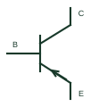

# PNP bipolar transistor

A bipolar transistor with base, collector and emitter terminals arranged for PNP operation.

[Canonical reference](https://eloragrid.ai/symbols/pnp-bipolar-transistor) · [Structured record](../entries/pnp-bipolar-transistor.json) · [All references](README.md)

Updated: 2026-10-27. Drawing use: Schematic. Reference families: Manufacturer.

## What it represents

A bipolar transistor with base, collector and emitter terminals arranged for PNP operation.
On a schematic, identify the base drive and emitter supply/reference and trace the collector load and switching or amplification path. Keep the component tag and signal/reference names consistent across the control drawing, terminal schedule and device documentation.
PNP polarity differs from NPN; mirrored graphics do not change a transistor's type or package pin assignment.
Terminal letters describe electrical roles, not package pin numbers. Check the selected public datasheet for the actual pin assignment, polarity and any internally connected terminals before completing the drawing.

## How to read it

- Identify the base drive and emitter supply/reference.
- Trace the collector load and switching or amplification path.

## Drawing checklist

- Label the base drive and emitter supply/reference.
- Cross-reference the collector load and switching or amplification path.
- Add the selected device or circuit documentation revision, power/reference connections and project signal convention.

## Important distinction

PNP polarity differs from NPN; mirrored graphics do not change a transistor's type or package pin assignment.

## Facts

- Common schematic mnemonic: PNP — descriptive only; project/device documentation defines reference designations.
- Terminal / interface focus: The base drive and emitter supply/reference
- Artwork scope: Original educational component glyph; not a certified standard graphic or package pinout.

## Public references

- [BC856/BC857/BC858 PNP transistor documentation](https://assets.nexperia.com/documents/data-sheet/BC856_BC857_BC858.pdf) — Nexperia. Public primary manufacturer documentation establishes the component function or circuit/topology relationship. Preview geometry and drafting explanations are independently authored.

## Related references

- [NPN bipolar transistor](npn-bipolar-transistor.md)
- [Diode](diode.md)

Original educational concept geometry, CC BY 4.0. Unitless; not a certified standards glyph or manufacturer footprint.

Elora-authored explanations are CC BY 4.0. Linked standards and manufacturer material retain their own rights. Confirm project requirements using primary sources.
