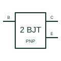

# PNP Darlington transistor

Two PNP transistor stages connected as a compound current-amplifying device.

[Canonical reference](https://eloragrid.ai/symbols/pnp-darlington-transistor) · [Structured record](../entries/pnp-darlington-transistor.json) · [All references](README.md)

Updated: 2026-10-27. Drawing use: Schematic. Reference families: Manufacturer.

## What it represents

Two PNP transistor stages connected as a compound current-amplifying device.
On a schematic, identify the common collector, input base and output emitter polarity and trace the high-side or amplification circuit. Keep the component tag and signal/reference names consistent across the control drawing, terminal schedule and device documentation.
A PNP Darlington has opposite operating polarity to an NPN pair; gain alone does not define an interchangeable device.
The preview is an independently drawn educational functional reference. Add the selected component’s actual power pins, terminal numbers, timing or analogue reference details when producing a construction drawing.

## How to read it

- Identify the common collector, input base and output emitter polarity.
- Trace the high-side or amplification circuit.

## Drawing checklist

- Label the common collector, input base and output emitter polarity.
- Cross-reference the high-side or amplification circuit.
- Add the selected device or circuit documentation revision, power/reference connections and project signal convention.

## Important distinction

A PNP Darlington has opposite operating polarity to an NPN pair; gain alone does not define an interchangeable device.

## Facts

- Common schematic mnemonic: PNP-DAR — descriptive only; project/device documentation defines reference designations.
- Terminal / interface focus: The common collector, input base and output emitter polarity
- Artwork scope: Original educational functional/circuit reference; not a selected product pinout.

## Public references

- [TIP120/TIP125 complementary Darlington transistor documentation](https://www.st.com/resource/en/datasheet/tip120.pdf) — STMicroelectronics. Public primary manufacturer documentation establishes the component function or circuit/topology relationship. Preview geometry and drafting explanations are independently authored.

## Related references

- [PNP bipolar transistor](pnp-bipolar-transistor.md)
- [Diode](diode.md)

Original educational concept geometry, CC BY 4.0. Unitless; not a certified standards glyph or manufacturer footprint.

Elora-authored explanations are CC BY 4.0. Linked standards and manufacturer material retain their own rights. Confirm project requirements using primary sources.
