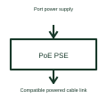

# PoE power-sourcing interface

A PoE power-sourcing interface manages the supply end of a compatible powered Ethernet connection.

[Canonical reference](https://eloragrid.ai/symbols/poe-power-sourcing-interface) · [Structured record](../entries/poe-power-sourcing-interface.json) · [All references](README.md)

Updated: 2026-10-27. Drawing use: Schematic. Reference families: Manufacturer.

## What it represents

A PoE power-sourcing interface manages the supply end of a compatible powered Ethernet connection.
A selected network switch can provide power to a recognised powered device through its PoE port.
Locate this function at the end providing power to the cable. Show detection and power control separately from the Ethernet data function. A port must use its selected PoE arrangement rather than simply placing a supply across arbitrary network conductors. This is original functional artwork, not a certified standard graphic or device pinout.

## How to read it

- Identify the sourcing port and intended powered device.
- Reference the supported classification and power-budget arrangement.
- Show protection and port-control connections from the selected design.
- A sourcing port's class and power capability must match the complete link and connected device.

## Drawing checklist

- Identify the sourcing port and intended powered device.
- Reference the supported classification and power-budget arrangement.
- Show protection and port-control connections from the selected design.

## Important distinction

A sourcing port's class and power capability must match the complete link and connected device.

## Facts

- Representation type: Original functional block; not a certified IEC or IEEE graphic
- Concept input: Port power supply
- Concept output: Compatible powered cable link

## Public references

- [Power over Ethernet interfaces](https://www.ti.com/product-category/power-management/power-over-ethernet-ics/overview.html) — Texas Instruments. Power over Ethernet interfaces: public technical context for the named function. Product and compliance details remain with the publisher.

## Related references

- [Industrial Ethernet switch](ga-industrial-ethernet-switch.md)
- [PoE powered-device interface](poe-powered-device-interface.md)
- [Power converter / inverter](power-converter.md)
- [Terminal connection](terminal.md)

Original educational concept geometry, CC BY 4.0. Unitless; not a certified standards glyph or manufacturer footprint.

Elora-authored explanations are CC BY 4.0. Linked standards and manufacturer material retain their own rights. Confirm project requirements using primary sources.
