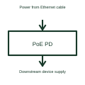

# PoE powered-device interface

A PoE powered-device interface manages the receiving end of power delivered over a compatible Ethernet link.

[Canonical reference](https://eloragrid.ai/symbols/poe-powered-device-interface) · [Structured record](../entries/poe-powered-device-interface.json) · [All references](README.md)

Updated: 2026-10-27. Drawing use: Schematic. Reference families: Manufacturer.

## What it represents

A PoE powered-device interface manages the receiving end of power delivered over a compatible Ethernet link.
A network-connected device can receive its operating power through the PoE connection.
Place the powered-device interface at the receiving end of the Ethernet power connection. Distinguish the incoming cable power, the recognition and classification functions, and the downstream supply conversion. The Ethernet data path and the power path need separate labels even when they share the same cable. This is original functional artwork, not a certified standard graphic or device pinout.

## How to read it

- Identify the powered-device and sourcing-equipment ends.
- Reference the selected power class and input arrangement.
- Show downstream conversion and the separate data path.
- The powered-device interface receives power; the sourcing equipment supplies it.

## Drawing checklist

- Identify the powered-device and sourcing-equipment ends.
- Reference the selected power class and input arrangement.
- Show downstream conversion and the separate data path.

## Important distinction

The powered-device interface receives power; the sourcing equipment supplies it.

## Facts

- Representation type: Original functional block; not a certified IEC or IEEE graphic
- Concept input: Power from Ethernet cable
- Concept output: Downstream device supply

## Public references

- [Power over Ethernet interfaces](https://www.ti.com/product-category/power-management/power-over-ethernet-ics/overview.html) — Texas Instruments. Power over Ethernet interfaces: public technical context for the named function. Product and compliance details remain with the publisher.

## Related references

- [Industrial Ethernet switch](ga-industrial-ethernet-switch.md)
- [PoE power-sourcing interface](poe-power-sourcing-interface.md)
- [Power converter / inverter](power-converter.md)
- [Terminal connection](terminal.md)

Original educational concept geometry, CC BY 4.0. Unitless; not a certified standards glyph or manufacturer footprint.

Elora-authored explanations are CC BY 4.0. Linked standards and manufacturer material retain their own rights. Confirm project requirements using primary sources.
