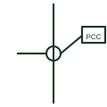

# Point of common coupling

A marker on a single-line diagram identifying where a customer installation or microgrid meets the public network.

[Canonical reference](https://eloragrid.ai/symbols/point-of-common-coupling) · [Structured record](../entries/point-of-common-coupling.json) · [All references](README.md)

Updated: 2026-10-28. Drawing use: SLD. Reference families: IEC, IEEE / ANSI.

## What it represents

The point of common coupling is the location on the network nearest to the installation where other customers are, or could be, connected. Harmonic, flicker and voltage limits in connection agreements are assessed at this point, and microgrid islanding decisions are often defined relative to it.
Drawings mark the point with a dot, circle, flag or label PCC on the busbar or cable, often together with the ownership boundary and the revenue meter. A microgrid may show both a PCC with the utility and internal points of connection for each source.
The marker carries no electrical function itself. It does not tell you the ownership boundary, which can differ from the PCC, or the fault level at that point, which must be stated for compliance assessments.

## How to read it

- Do not assume the PCC and the ownership boundary coincide.
- Power quality limits are assessed here.

## Drawing checklist

- State voltage level and fault level at the PCC.
- Show the ownership boundary separately.
- Reference connection agreement limits.

## Important distinction

A PCC marks an assessment point; a utility grid connection symbol represents the supply itself.

## Facts

- Electrical function: None, a reference marker
- Used for: Power quality and connection limits
- Preview: Independent educational illustration; exact standard graphic not certified

## Public references

- [Electrical installation design methodology and references](https://www.electrical-installation.org/enwiki/General_rules_of_electrical_installation_design) — Schneider Electric — Electrical Installation Guide. Public electrical installation design references covering supply connection.
- [Reliable hybrid power and microgrid solutions](https://www.deif.com/applications/power-generation/reliable-hybrid-power-and-microgrid-solutions/) — DEIF. Public microgrid context with mains import and export at the connection point.

## Related references

- [Utility grid connection](utility-grid-connection.md)
- [Microgrid interconnection switch](microgrid-interconnection-switch.md)
- [Busbar](busbar.md)

Original educational concept geometry, CC BY 4.0. Unitless; not a certified standards glyph or manufacturer footprint.

Elora-authored explanations are CC BY 4.0. Linked standards and manufacturer material retain their own rights. Confirm project requirements using primary sources.
