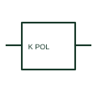

# Polarised relay coil

A polarised relay has operation or a specified response that depends on the documented electrical polarity.

[Canonical reference](https://eloragrid.ai/symbols/polarised-relay-coil) · [Structured record](../entries/polarised-relay-coil.json) · [All references](README.md)

Updated: 2026-10-27. Drawing use: Schematic. Reference families: IEC, Manufacturer.

## What it represents

A polarised relay has operation or a specified response that depends on the documented electrical polarity. Its terminal and polarity markings must be preserved when the drawing is rearranged.

## How to read it

- The device polarity is established by terminal data, not by the left-to-right direction of a rung.
- The preview is an original explanation of this function. Match the actual drawing convention to its legend and the selected equipment documentation.

## Drawing checklist

- Show coil polarity
- State operating voltage
- Reference contact behaviour

## Important distinction

Polarised relay operation is different from merely fitting a suppression diode to an otherwise ordinary coil.

## Facts

- Drawing role: Relay operation
- Representation scope: Functional concept; not an official standard graphic or a product footprint
- Public vendor block reference: HCR1POL, VCR1POL (Autodesk identifiers; not IEC symbol numbers)
- Identifier status: The short label is a functional lookup label, not an assigned IEC or IEEE symbol number. Any separately listed Autodesk code is a verified vendor block name.

## Public references

- [Relays and contacts: public symbol reference](https://help.autodesk.com/cloudhelp/2021/ENU/AutoCAD-Electrical/files/GUID-011C62B8-9EC8-485C-B47D-B22A3F7B7574.htm) — Autodesk. Public documentation of this equipment function or named vendor variant; the illustration is independently authored and is not the source graphic.

## Related references

- [Relay coil](relay-coil.md)
- [Normally open contact](normally-open-contact.md)

Original educational concept geometry, CC BY 4.0. Unitless; not a certified standards glyph or manufacturer footprint.

Elora-authored explanations are CC BY 4.0. Linked standards and manufacturer material retain their own rights. Confirm project requirements using primary sources.
