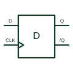

# Positive-edge D flip-flop

Captures its data input at the documented positive clock edge and retains that digital state.

[Canonical reference](https://eloragrid.ai/symbols/positive-edge-d-flip-flop) · [Structured record](../entries/positive-edge-d-flip-flop.json) · [All references](README.md)

Updated: 2026-10-27. Drawing use: Schematic. Reference families: Manufacturer.

## What it represents

Captures its data input at the documented positive clock edge and retains that digital state.
On a schematic, identify the D input, clock edge and asynchronous preset/clear polarities and trace the stored Q output and any complemented output. Keep the component tag and signal/reference names consistent across the control drawing, terminal schedule and device documentation.
An edge-triggered flip-flop differs from a transparent latch; data timing relative to the clock remains essential.
The preview is an independently drawn educational functional reference. Add the selected component’s actual power pins, terminal numbers, timing or analogue reference details when producing a construction drawing.

## How to read it

- Identify the D input, clock edge and asynchronous preset/clear polarities.
- Trace the stored Q output and any complemented output.

## Drawing checklist

- Label the D input, clock edge and asynchronous preset/clear polarities.
- Cross-reference the stored Q output and any complemented output.
- Add the selected device or circuit documentation revision, power/reference connections and project signal convention.

## Important distinction

An edge-triggered flip-flop differs from a transparent latch; data timing relative to the clock remains essential.

## Facts

- Common schematic mnemonic: D-FF — descriptive only; project/device documentation defines reference designations.
- Terminal / interface focus: The D input, clock edge and asynchronous preset/clear polarities
- Artwork scope: Original educational functional/circuit reference; not a selected product pinout.

## Public references

- [SN74HC74 — positive-edge D flip-flops](https://www.ti.com/lit/ds/symlink/sn74hc74.pdf) — Texas Instruments. Public primary manufacturer documentation establishes the component function or circuit/topology relationship. Preview geometry and drafting explanations are independently authored.

## Related references

- [Transparent D latch](transparent-d-latch.md)
- [PLC input / output](plc-io.md)

Original educational concept geometry, CC BY 4.0. Unitless; not a certified standards glyph or manufacturer footprint.

Elora-authored explanations are CC BY 4.0. Linked standards and manufacturer material retain their own rights. Confirm project requirements using primary sources.
