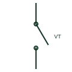

# Potential test switch

Panel test switch that opens a VT secondary circuit to a relay or meter so test voltages can be applied safely.

[Canonical reference](https://eloragrid.ai/symbols/potential-test-switch) · [Structured record](../entries/potential-test-switch.json) · [All references](README.md)

Updated: 2026-10-28. Drawing use: Schematic. Reference families: IEEE / ANSI, Manufacturer.

## What it represents

A potential test switch is a knife switch in a VT secondary circuit that isolates a relay or meter from the VT so test voltages can be injected. Unlike a current switch it has no shorting contact, because a VT secondary must never be shorted.
When the switch is open, protection that relies on the voltage may be disabled or may see loss of voltage. The symbol does not show that consequence, so the test procedure should list the functions affected and whether any trip outputs must also be isolated.

## How to read it

- Confirm there is no shorting contact on VT circuits.
- List functions affected when the switch is open.

## Drawing checklist

- Identify VT and relay sides
- Show associated trip isolation
- Reference test procedure

## Important distinction

A potential test switch opens a voltage circuit; a current test switch shorts the CT before opening.

## Facts

- Circuit: VT secondary
- Shorting contact: None
- Preview: Functional illustration of the device role; not a product footprint or certified standard graphic

## Public references

- [Transformer terminals for measuring and test circuits](https://www.phoenixcontact.com/en-ie/products/terminal-blocks/transformer-terminal-blocks?p=7) — Phoenix Contact. Public manufacturer range of transformer and test terminals for measuring and protection circuits.
- [IEEE/ANSI 315-1975: graphic symbols for electrical and electronics diagrams](https://standards.ieee.org/ieee/315/515/) — IEEE Standards Association. IEEE graphic-symbol standards context; no standard glyph is reproduced.

## Related references

- [Current test switch with shorting contact](current-test-switch-with-shorting.md)
- [Relay test block](relay-test-block.md)
- [Voltage transformer](voltage-transformer.md)

Original educational concept geometry, CC BY 4.0. Unitless; not a certified standards glyph or manufacturer footprint.

Elora-authored explanations are CC BY 4.0. Linked standards and manufacturer material retain their own rights. Confirm project requirements using primary sources.
