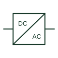

# Power converter / inverter

An identified interface converting electrical power between documented circuit forms.

[Canonical reference](https://eloragrid.ai/symbols/power-converter) · [Structured record](../entries/power-converter.json) · [All references](README.md)

Updated: 2026-10-27. Drawing use: SLD, Schematic. Reference families: IEC, IEEE / ANSI.

## What it represents

A power converter changes electrical power between the circuit forms specified for its application. In a battery energy storage system, a power conversion system commonly provides the interface between DC storage and an AC system. Direction of power flow and operating capabilities are product-specific.
The drawing should label the AC and DC interfaces and identify switching, protection and controls separately. A generic converter box does not establish grid-forming, grid-following, island operation or export capability. Those behaviours require the selected product and system documentation.

## How to read it

- Read the AC/DC interface labels before following power flow.
- Identify the selected operating capabilities from the product and system documentation.

## Drawing checklist

- Identify AC and DC interfaces.
- Reference the selected converter and control equipment.
- Cross-reference isolation and protective devices.

## Important distinction

Inverter, converter and PCS can denote different equipment boundaries. Define what is included in the represented assembly.

## Facts

- Interfaces: Application-specific AC and DC connections
- Power-flow direction: Product-specific
- Operating capabilities: Not established by the generic graphic

## Public references

- [Battery energy storage and power conversion](https://www.eaton.com/sg/en-us/products/energy-storage.html) — Eaton. Manufacturer explanation of the DC-storage to AC power-conversion interface.

## Related references

- [Battery](battery.md)
- [Power conversion cabinet](pcs-cabinet.md)
- [Battery storage cabinet](battery-cabinet.md)
- [Circuit breaker](circuit-breaker.md)

Original educational concept geometry, CC BY 4.0. Unitless; not a certified standards glyph or manufacturer footprint.

Elora-authored explanations are CC BY 4.0. Linked standards and manufacturer material retain their own rights. Confirm project requirements using primary sources.
