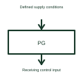

# Power-good indication

A power-good signal reports whether the source's specified acceptable-supply conditions are satisfied.

[Canonical reference](https://eloragrid.ai/symbols/power-good-indication) · [Structured record](../entries/power-good-indication.json) · [All references](README.md)

Updated: 2026-10-27. Drawing use: Schematic. Reference families: Manufacturer.

## What it represents

A power-good signal reports whether the source's specified acceptable-supply conditions are satisfied.
A downstream circuit can use this status when deciding whether to enable its operation.
Draw power-good as a status signal from its source or supervisor to the receiving controller. It is information about specified acceptable conditions, not the supply conductor itself. State the active level and timing requirements from the selected source so the receiving circuit interprets it correctly. This is original functional artwork, not a certified standard graphic or device pinout.

## How to read it

- Identify the device generating the indication.
- Show the active level and receiving input.
- Reference acceptable conditions and assertion/release timing.
- Power-good timing and thresholds come from the selected source or supervisor.

## Drawing checklist

- Identify the device generating the indication.
- Show the active level and receiving input.
- Reference acceptable conditions and assertion/release timing.

## Important distinction

Power-good timing and thresholds come from the selected source or supervisor.

## Facts

- Representation type: Original functional block; not a certified IEC or IEEE graphic
- Concept input: Defined supply conditions
- Concept output: Receiving control input

## Public references

- [Supply supervision and reset](https://www.ti.com/product-category/power-management/supervisor-reset-ics/overview.html) — Texas Instruments. Supply supervision and reset: public technical context for the named function. Product and compliance details remain with the publisher.

## Related references

- [Watchdog timer](watchdog-timer.md)
- [Supply voltage supervisor](supply-voltage-supervisor.md)
- [Window voltage supervisor](window-voltage-supervisor.md)
- [Power converter / inverter](power-converter.md)

Original educational concept geometry, CC BY 4.0. Unitless; not a certified standards glyph or manufacturer footprint.

Elora-authored explanations are CC BY 4.0. Linked standards and manufacturer material retain their own rights. Confirm project requirements using primary sources.
