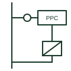

# Power plant controller

The plant-level controller that measures at the connection point and sets inverter or turbine outputs to meet grid requirements.

[Canonical reference](https://eloragrid.ai/symbols/power-plant-controller) · [Structured record](../entries/power-plant-controller.json) · [All references](README.md)

Updated: 2026-10-28. Drawing use: SLD. Reference families: IEC, IEEE / ANSI.

## What it represents

A power plant controller measures voltage, current, active and reactive power at the plant connection point and adjusts setpoints of all inverters or turbines to meet the network operator's requirements. Typical functions include active power limits, ramp rates, frequency response, voltage or reactive power control and power factor control.
Drawings show a control block with measurement inputs from the connection point CTs and VTs, a communication network to each inverter or turbine, and a link to the network operator's control system. A meter at the point of connection is usually the measurement source.
The controller's response speed is slower than the inverter internal controls, so fast events are still handled by the devices themselves. The symbol does not show control modes, settings or the response time agreed with the network operator.

## How to read it

- Measurement comes from the connection point, not individual inverters.
- Communication dashed lines show the setpoint path.

## Drawing checklist

- List control modes and the measurement point.
- Show communication to each unit.
- Reference agreed performance settings.

## Important distinction

A power plant controller manages one generating plant at its connection point; a microgrid controller also manages loads and islanding.

## Facts

- Measurement point: Plant connection point
- Controls: P, Q, voltage, ramp, frequency response
- Targets: Inverters or turbines
- Preview: Independent educational illustration; consult the applicable standard and project legend for the exact graphic

## Public references

- [Solar electrical system architecture](https://www.ti.com/applications/industrial/energy-infrastructure/solar-energy/overview.html) — Texas Instruments. Public solar plant architecture context.
- [Reliable hybrid power and microgrid solutions](https://www.deif.com/applications/power-generation/reliable-hybrid-power-and-microgrid-solutions/) — DEIF. Public hybrid plant control context.

## Related references

- [Microgrid controller](microgrid-controller.md)
- [Point of common coupling](point-of-common-coupling.md)
- [Grid-following inverter](grid-following-inverter.md)
- [Full-converter wind turbine generator (Type 4)](full-converter-wind-turbine-generator.md)

Original educational concept geometry, CC BY 4.0. Unitless; not a certified standards glyph or manufacturer footprint.

Elora-authored explanations are CC BY 4.0. Linked standards and manufacturer material retain their own rights. Confirm project requirements using primary sources.
