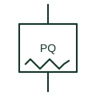

# Power quality analyser

Instrument that measures and logs harmonics, flicker, dips, swells and unbalance at a point of the network.

[Canonical reference](https://eloragrid.ai/symbols/power-quality-analyser) · [Structured record](../entries/power-quality-analyser.json) · [All references](README.md)

Updated: 2026-10-28. Drawing use: SLD, Schematic. Reference families: IEC, Manufacturer.

## What it represents

A power quality analyser measures disturbances as well as ordinary quantities: harmonics, flicker, voltage dips and swells, unbalance and transients. It is installed at supply points and sensitive loads to show whether supply quality meets the agreed limits, and it keeps event logs for investigation.
Measurement methods for power quality are standardised so that different instruments give comparable results, and the class of measurement matters when results are used in disputes. The symbol does not show that class, the VT and CT bandwidth or the logging settings.

## How to read it

- Check the measurement class claimed for the analyser.
- Confirm CT and VT are suitable for harmonic frequencies.

## Drawing checklist

- State measurement class
- Show CT and VT sources
- Reference logging settings

## Important distinction

A power quality analyser assesses disturbances; a multifunction meter mainly reports fundamental quantities and energy.

## Facts

- Measured quantities: Harmonics, flicker, dips, swells and unbalance
- Records: Event and trend logs
- Preview: Functional illustration of the device role; not a product footprint or certified standard graphic

## Public references

- [PowerLogic ION9000 user manual](https://www.se.com/us/en/download/document/26719674/) — Schneider Electric. Public meter manual describing measurement, logging and recording features of a revenue and power-quality meter.
- [IEC graphical symbols for diagrams](https://tc3.iec.ch/tc-activity/graphical-symbols-for-diagrams/) — IEC. IEC context for graphical symbols used in diagrams; no IEC graphic is reproduced.

## Related references

- [Multifunction power meter](multifunction-power-meter.md)
- [Disturbance recorder](disturbance-recorder.md)
- [Recording voltmeter](recording-voltmeter.md)

Original educational concept geometry, CC BY 4.0. Unitless; not a certified standards glyph or manufacturer footprint.

Elora-authored explanations are CC BY 4.0. Linked standards and manufacturer material retain their own rights. Confirm project requirements using primary sources.
