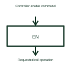

# Power-rail enable interface

An enable interface requests a selected power supply or switched rail to operate.

[Canonical reference](https://eloragrid.ai/symbols/power-rail-enable-interface) · [Structured record](../entries/power-rail-enable-interface.json) · [All references](README.md)

Updated: 2026-10-27. Drawing use: Schematic. Reference families: Manufacturer.

## What it represents

An enable interface requests a selected power supply or switched rail to operate.
A sequencer can drive the enable input of a regulator while separately monitoring its status.
Draw enable as a command entering the regulator or switch, and show the resulting supply output separately. If status is returned, label that connection independently. This prevents the command to operate from being mistaken for confirmation that the power rail is healthy. This is original functional artwork, not a certified standard graphic or device pinout.

## How to read it

- Identify the device receiving enable.
- State the enable signal’s active condition.
- Show the separate supply output and status feedback if used.
- Enable is a command input; power-good is a condition output.

## Drawing checklist

- Identify the device receiving enable.
- State the enable signal’s active condition.
- Show the separate supply output and status feedback if used.

## Important distinction

Enable is a command input; power-good is a condition output.

## Facts

- Representation type: Original functional block; not a certified IEC or IEEE graphic
- Concept input: Controller enable command
- Concept output: Requested rail operation

## Public references

- [Power supply sequencing](https://www.ti.com/product-category/power-management/sequencers/overview.html) — Texas Instruments. Power supply sequencing: public technical context for the named function. Product and compliance details remain with the publisher.

## Related references

- [PLC input / output](plc-io.md)
- [Power-rail sequencer](power-rail-sequencer.md)
- [Power converter / inverter](power-converter.md)
- [Terminal connection](terminal.md)

Original educational concept geometry, CC BY 4.0. Unitless; not a certified standards glyph or manufacturer footprint.

Elora-authored explanations are CC BY 4.0. Linked standards and manufacturer material retain their own rights. Confirm project requirements using primary sources.
