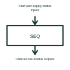

# Power-rail sequencer

A power sequencer controls the order in which selected supply rails are enabled or disabled.

[Canonical reference](https://eloragrid.ai/symbols/power-rail-sequencer) · [Structured record](../entries/power-rail-sequencer.json) · [All references](README.md)

Updated: 2026-10-27. Drawing use: Schematic. Reference families: Manufacturer.

## What it represents

A power sequencer controls the order in which selected supply rails are enabled or disabled.
A controller board can bring its supplies up in the order required by its devices.
Show each rail-enable output and any feedback used to decide the next step. An ordered command is different from proof that a supply reached its intended condition. The drawing should therefore distinguish the requested sequence, actual rail voltages and the status inputs used by the controller. This is original functional artwork, not a certified standard graphic or device pinout.

## How to read it

- Identify each controlled rail and enable output.
- Show feedback used to advance or stop the sequence.
- Reference startup, shutdown and fault sequencing.
- An ordered enable signal does not itself prove that a rail reached its intended voltage.

## Drawing checklist

- Identify each controlled rail and enable output.
- Show feedback used to advance or stop the sequence.
- Reference startup, shutdown and fault sequencing.

## Important distinction

An ordered enable signal does not itself prove that a rail reached its intended voltage.

## Facts

- Representation type: Original functional block; not a certified IEC or IEEE graphic
- Concept input: Start and supply-status inputs
- Concept output: Ordered rail-enable outputs

## Public references

- [Power supply sequencing](https://www.ti.com/product-category/power-management/sequencers/overview.html) — Texas Instruments. Power supply sequencing: public technical context for the named function. Product and compliance details remain with the publisher.

## Related references

- [PLC input / output](plc-io.md)
- [Power-rail enable interface](power-rail-enable-interface.md)
- [Power converter / inverter](power-converter.md)
- [Terminal connection](terminal.md)

Original educational concept geometry, CC BY 4.0. Unitless; not a certified standards glyph or manufacturer footprint.

Elora-authored explanations are CC BY 4.0. Linked standards and manufacturer material retain their own rights. Confirm project requirements using primary sources.
