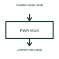

# Power-source multiplexer

A power multiplexer selects between defined supply paths feeding an output.

[Canonical reference](https://eloragrid.ai/symbols/power-source-multiplexer) · [Structured record](../entries/power-source-multiplexer.json) · [All references](README.md)

Updated: 2026-10-27. Drawing use: Schematic. Reference families: Manufacturer.

## What it represents

A power multiplexer selects between defined supply paths feeding an output.
A device can transfer between two supported input sources under its selected control rule.
Show every permitted supply input and the common output, together with the source-selection rule. This block switches a power path, whereas a signal multiplexer routes information. Any seamless transfer, reverse blocking or current limits depend on the selected circuit rather than the block name. This is original functional artwork, not a certified standard graphic or device pinout.

## How to read it

- Label the candidate supply inputs and common output.
- Identify the source-priority or selection controls.
- Reference transfer behaviour and any reverse-current requirements.
- A power multiplexer switches supply paths; a signal multiplexer switches information paths.

## Drawing checklist

- Label the candidate supply inputs and common output.
- Identify the source-priority or selection controls.
- Reference transfer behaviour and any reverse-current requirements.

## Important distinction

A power multiplexer switches supply paths; a signal multiplexer switches information paths.

## Facts

- Representation type: Original functional block; not a certified IEC or IEEE graphic
- Concept input: Available supply inputs
- Concept output: Common load supply

## Public references

- [Power-path protection and selection](https://www.ti.com/product-category/power-management/power-protection-switches-controllers/overview.html) — Texas Instruments. Power-path protection and selection: public technical context for the named function. Product and compliance details remain with the publisher.

## Related references

- [Hot-swap controller](hot-swap-controller.md)
- [Reverse-polarity protection controller](reverse-polarity-protection-controller.md)
- [Power converter / inverter](power-converter.md)
- [Terminal connection](terminal.md)

Original educational concept geometry, CC BY 4.0. Unitless; not a certified standards glyph or manufacturer footprint.

Elora-authored explanations are CC BY 4.0. Linked standards and manufacturer material retain their own rights. Confirm project requirements using primary sources.
