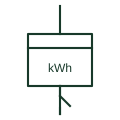

# Prepayment energy meter

Energy meter with credit control that disconnects supply through an integral switch when credit is used up.

[Canonical reference](https://eloragrid.ai/symbols/prepayment-energy-meter) · [Structured record](../entries/prepayment-energy-meter.json) · [All references](README.md)

Updated: 2026-10-28. Drawing use: SLD, Schematic. Reference families: IEC, Manufacturer.

## What it represents

A prepayment meter combines an energy register with a credit system and a supply switch. When credit is exhausted the switch opens the supply, so on the schematic the meter includes or controls a load switch in the main circuit as well as its measuring element.
The integral switch is a disconnection device rather than protection. The symbol does not show emergency credit arrangements or which circuits are supplied through the switch, and essential loads may need to be wired so they are not interrupted.

## How to read it

- Identify which circuits pass through the meter's switch.
- Check that protection is provided separately.

## Drawing checklist

- Show integral switch
- Identify switched circuits
- Reference protective device

## Important distinction

A prepayment meter can switch the supply off; an ordinary energy meter only measures.

## Facts

- Added function: Credit control with supply switch
- Typical use: Residential and tenancy supplies
- Preview: Independent educational concept; consult the applicable standard and project legend for the exact graphic

## Public references

- [IEC graphical symbols for diagrams](https://tc3.iec.ch/tc-activity/graphical-symbols-for-diagrams/) — IEC. IEC context for graphical symbols used in diagrams; no IEC graphic is reproduced.
- [Power and energy measurement quantities](https://www.se.com/ph/en/faqs/FA343278/) — Schneider Electric. Public explanation of energy and power measurement quantities used by meters.

## Related references

- [Active-energy meter](active-energy-meter.md)
- [Integrating instrument general symbol](integrating-instrument-general-symbol.md)
- [Load-break switch](load-break-switch.md)

Original educational concept geometry, CC BY 4.0. Unitless; not a certified standards glyph or manufacturer footprint.

Elora-authored explanations are CC BY 4.0. Linked standards and manufacturer material retain their own rights. Confirm project requirements using primary sources.
