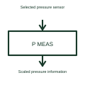

# Pressure measurement interface

A pressure interface converts the selected pressure sensor's response into usable measurement information.

[Canonical reference](https://eloragrid.ai/symbols/pressure-measurement-interface) · [Structured record](../entries/pressure-measurement-interface.json) · [All references](README.md)

Updated: 2026-10-27. Drawing use: Schematic. Reference families: Manufacturer.

## What it represents

A pressure interface converts the selected pressure sensor's response into usable measurement information.
A control system can read a pressure transducer through its matching measurement electronics.
Identify the pressure sensor and its reference convention, such as gauge, absolute or differential pressure where applicable. Then show the conditioning and output interface. A voltage or current signal only represents pressure after the selected range and scaling are known. This is original functional artwork, not a certified standard graphic or device pinout.

## How to read it

- Identify the pressure reference and measurement range.
- Show the sensor and conditioning/interface boundaries.
- Reference output scaling, supply and connection requirements.
- The sensor's pressure reference and range must be known; an electrical signal alone does not define them.

## Drawing checklist

- Identify the pressure reference and measurement range.
- Show the sensor and conditioning/interface boundaries.
- Reference output scaling, supply and connection requirements.

## Important distinction

The sensor's pressure reference and range must be known; an electrical signal alone does not define them.

## Facts

- Representation type: Original functional block; not a certified IEC or IEEE graphic
- Concept input: Selected pressure sensor
- Concept output: Scaled pressure information

## Public references

- [Pressure-transmitter measurement chain](https://www.ti.com/solution/pressure-transmitter) — Texas Instruments. Primary-source technical context for this particular function; product-specific ratings remain with the manufacturer.

## Related references

- [Temperature measuring transducer](temperature-measuring-transducer.md)
- [Hall-effect current sensor](hall-effect-current-sensor.md)
- [Magnetic position sensor](magnetic-position-sensor.md)
- [Inductive position sensor](inductive-position-sensor.md)

Original educational concept geometry, CC BY 4.0. Unitless; not a certified standards glyph or manufacturer footprint.

Elora-authored explanations are CC BY 4.0. Linked standards and manufacturer material retain their own rights. Confirm project requirements using primary sources.
