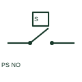

# Pressure switch NO

A pressure-operated NO switch closes when its documented pressure condition actuates the mechanism.

[Canonical reference](https://eloragrid.ai/symbols/pressure-switch-no) · [Structured record](../entries/pressure-switch-no.json) · [All references](README.md)

Updated: 2026-10-27. Drawing use: Schematic. Reference families: IEC, Manufacturer.

## What it represents

A pressure-operated NO switch closes when its documented pressure condition actuates the mechanism. Increasing or decreasing pressure behaviour must be identified rather than inferred from NO.

## How to read it

- Specify the actuation direction and reset differential from product data.
- The preview is an original explanation of this function. Match the actual drawing convention to its legend and the selected equipment documentation.

## Drawing checklist

- Label monitored pressure
- State operate and reset conditions
- Identify contact terminals

## Important distinction

NO is the unactuated contact state; high-pressure or low-pressure describes the process condition.

## Facts

- Drawing role: Actuated indication
- Representation scope: Functional concept; not an official standard graphic or a product footprint
- Public vendor block reference: HPS11, VPS11 (Autodesk identifiers; not IEC symbol numbers)
- Identifier status: The short label is a functional lookup label, not an assigned IEC or IEEE symbol number. Any separately listed Autodesk code is a verified vendor block name.

## Public references

- [AutoCAD Electrical: Pressure and temperature switches](https://help.autodesk.com/cloudhelp/2021/ENU/AutoCAD-Electrical/files/GUID-46061E42-55B7-4804-8D50-C31DF292F01D.htm) — Autodesk. Public documentation of this equipment function or named vendor variant; the illustration is independently authored and is not the source graphic.

## Related references

- [PLC input / output](plc-io.md)
- [Normally open contact](normally-open-contact.md)

Original educational concept geometry, CC BY 4.0. Unitless; not a certified standards glyph or manufacturer footprint.

Elora-authored explanations are CC BY 4.0. Linked standards and manufacturer material retain their own rights. Confirm project requirements using primary sources.
