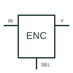

# Priority encoder

Encodes the highest-priority qualifying input into the specified binary output word.

[Canonical reference](https://eloragrid.ai/symbols/priority-encoder) · [Structured record](../entries/priority-encoder.json) · [All references](README.md)

Updated: 2026-10-27. Drawing use: Schematic. Reference families: Manufacturer.

## What it represents

Encodes the highest-priority qualifying input into the specified binary output word.
On a schematic, identify the input active levels, priority order and enable controls and trace the encoded outputs and validity/cascade signals. Keep the component tag and signal/reference names consistent across the control drawing, terminal schedule and device documentation.
A priority encoder resolves simultaneous inputs using its specified order; a basic encoder does not necessarily resolve them.
The preview is an independently drawn educational functional reference. Add the selected component’s actual power pins, terminal numbers, timing or analogue reference details when producing a construction drawing.

## How to read it

- Identify the input active levels, priority order and enable controls.
- Trace the encoded outputs and validity/cascade signals.

## Drawing checklist

- Label the input active levels, priority order and enable controls.
- Cross-reference the encoded outputs and validity/cascade signals.
- Add the selected device or circuit documentation revision, power/reference connections and project signal convention.

## Important distinction

A priority encoder resolves simultaneous inputs using its specified order; a basic encoder does not necessarily resolve them.

## Facts

- Common schematic mnemonic: ENC-PRI — descriptive only; project/device documentation defines reference designations.
- Terminal / interface focus: The input active levels, priority order and enable controls
- Artwork scope: Original educational functional/circuit reference; not a selected product pinout.

## Public references

- [SN74HC148 — priority encoding](https://www.ti.com/lit/ds/symlink/sn74hc148.pdf) — Texas Instruments. Public primary manufacturer documentation establishes the component function or circuit/topology relationship. Preview geometry and drafting explanations are independently authored.

## Related references

- [Binary decoder / demultiplexer](binary-decoder-demultiplexer.md)
- [PLC input / output](plc-io.md)

Original educational concept geometry, CC BY 4.0. Unitless; not a certified standards glyph or manufacturer footprint.

Elora-authored explanations are CC BY 4.0. Linked standards and manufacturer material retain their own rights. Confirm project requirements using primary sources.
