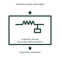

# Protection channel asymmetric-delay indication

Identifies a measured or declared difference between the communication path directions.

[Canonical reference](https://eloragrid.ai/symbols/protection-channel-asymmetric-delay-indication) · [Structured record](../entries/protection-channel-asymmetric-delay-indication.json) · [All references](README.md)

Updated: 2026-11-03. Drawing use: Schematic. Reference families: Manufacturer.

Representation: functional-block; installation focus: switchyards.
Directional delay information
Asymmetry indication

## What it represents

Identifies a measured or declared difference between the communication path directions. A protection communication interface carries information between circuit ends or couples a communication signal to a primary line. Its signal path is different from the power-current path even when both use part of the same installation.
In a switchyard line bay, carrier-coupling equipment can connect a protection communication terminal to the transmission conductor. Fiber-based protection uses another physical path but still needs named endpoints and channel supervision. For this reference, the drawing identifies “Directional delay information” at the input and “Asymmetry indication” at the output. Compensation depends on the selected protection implementation.
Show each coupling boundary and the intended information direction. Frequency selection, channel performance, insulation duty and protective coordination require the selected communication and primary equipment design. The functional block is an independent explanation of this named application. Equipment-specific ratings, terminal connections and operating conditions must be established in the project documentation.

## How to read it

- Start at the named input: Directional delay information. Identify its source device or document and the state represented on the drawing.
- Follow the named output: Asymmetry indication. Cross-reference its destination and separate the command from confirmation that the equipment responded.
- Compensation depends on the selected protection implementation.
- Show each coupling boundary and the intended information direction. Frequency selection, channel performance, insulation duty and protective coordination require the selected communication and primary equipment design.

## Drawing checklist

- Label the source and connection reference for directional delay information.
- Identify the destination and defined state of asymmetry indication.
- Record the equipment or control-document revision supporting this functional block.
- Check this application limit in the project design: Compensation depends on the selected protection implementation.

## Important distinction

Compensation depends on the selected protection implementation. This reference describes the named application; it does not establish a new IEC graphical symbol, an ANSI device-function number or an exact manufacturer connection diagram.

## Facts

- Representation: Functional block
- Installation focus: Switchyards
- Input / boundary: Directional delay information
- Output / connection: Asymmetry indication
- Lookup label: PCAI is a library lookup label, not a standard device designation.

## Public references

- [Line traps: power-line carrier communication](https://www.gevernova.com/grid-solutions/sites/default/files/2025-09/Line-Traps-Brochure-EN-N50059-Hybrid-202504-R002.pdf) — GE Vernova. Public technical context for line carrier and protection communication interfaces. Line traps, coupling and power-line carrier communications. The application text and educational graphic are independently authored; the publisher does not certify this representation.

## Related references

- [Capacitor voltage transformer](capacitor-voltage-transformer.md)
- [Pilot or carrier receiver relay](85-pilot-or-carrier-receiver-relay.md)
- [Protection communication redundant-path selector](protection-communication-redundant-path-selector.md)

Original educational concept geometry, CC BY 4.0. Unitless; not a certified standards glyph or manufacturer footprint.

Elora-authored explanations are CC BY 4.0. Linked standards and manufacturer material retain their own rights. Confirm project requirements using primary sources.
