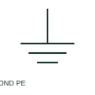

# Protective equipotential bonding

Protective equipotential bonding connects documented conductive parts as part of the protective arrangement.

[Canonical reference](https://eloragrid.ai/symbols/protective-equipotential-bonding) · [Structured record](../entries/protective-equipotential-bonding.json) · [All references](README.md)

Updated: 2026-10-27. Drawing use: SLD, Schematic. Reference families: IEC, Manufacturer.

## What it represents

Protective equipotential bonding connects documented conductive parts as part of the protective arrangement. The schematic and layout identify the actual bonding network and connection points.

## How to read it

- Identify the conductive parts connected by the bond.
- The preview is an original explanation of this function. Match the actual drawing convention to its legend and the selected equipment documentation.

## Drawing checklist

- List bonded parts
- Show bond connection points
- Reference conductor specification

## Important distinction

Bonding connects parts together; an earth electrode establishes a connection to earth.

## Facts

- Drawing role: Earth or bonding role
- Representation scope: Functional concept; not an official standard graphic or a product footprint
- Public vendor block reference: HGND5, VGND5 (Autodesk identifiers; not IEC symbol numbers)
- Identifier status: The short label is a functional lookup label, not an assigned IEC or IEEE symbol number. Any separately listed Autodesk code is a verified vendor block name.

## Public references

- [AutoCAD Electrical: Earthing, sources and surge protection](https://help.autodesk.com/cloudhelp/2021/ENU/AutoCAD-Electrical/files/GUID-1E3FDEAE-B4B2-417C-8075-108AA2C6E509.htm) — Autodesk. Public documentation of this equipment function or named vendor variant; the illustration is independently authored and is not the source graphic.

## Related references

- [Protective earth](protective-earth.md)
- [Earthing switch](earthing-switch.md)

Original educational concept geometry, CC BY 4.0. Unitless; not a certified standards glyph or manufacturer footprint.

Elora-authored explanations are CC BY 4.0. Linked standards and manufacturer material retain their own rights. Confirm project requirements using primary sources.
