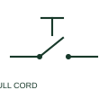

# Pull-cord switch

A pull-cord switch converts a cord-operated mechanical action into an electrical contact change.

[Canonical reference](https://eloragrid.ai/symbols/pull-cord-switch) · [Structured record](../entries/pull-cord-switch.json) · [All references](README.md)

Updated: 2026-10-27. Drawing use: Schematic. Reference families: IEC, Manufacturer.

## What it represents

A pull-cord switch converts a cord-operated mechanical action into an electrical contact change. The control drawing records the contact function, while the layout records the cord route and actuator placement.

## How to read it

- State the normal condition and how operation is reset.
- The preview is an original explanation of this function. Match the actual drawing convention to its legend and the selected equipment documentation.

## Drawing checklist

- Identify contact action
- Reference cord arrangement
- Show reset mechanism

## Important distinction

A generic pull-cord symbol does not certify an emergency-stop function.

## Facts

- Drawing role: Manual operation
- Representation scope: Functional concept; not an official standard graphic or a product footprint
- Public vendor block reference: HPC12, VPC12 (Autodesk identifiers; not IEC symbol numbers)
- Identifier status: The short label is a functional lookup label, not an assigned IEC or IEEE symbol number. Any separately listed Autodesk code is a verified vendor block name.

## Public references

- [AutoCAD Electrical: Level, flow, keyed and measurement switches](https://help.autodesk.com/cloudhelp/2021/ENU/AutoCAD-Electrical/files/GUID-1FB94435-C954-4479-BD97-25796DB8F728.htm) — Autodesk. Public documentation of this equipment function or named vendor variant; the illustration is independently authored and is not the source graphic.

## Related references

- [Normally open pushbutton](pushbutton-no.md)
- [Normally closed pushbutton](pushbutton-nc.md)

Original educational concept geometry, CC BY 4.0. Unitless; not a certified standards glyph or manufacturer footprint.

Elora-authored explanations are CC BY 4.0. Linked standards and manufacturer material retain their own rights. Confirm project requirements using primary sources.
