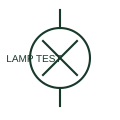

# Push-to-test indicator lamp

A push-to-test indicator lamp allows a documented local test of the lamp circuit.

[Canonical reference](https://eloragrid.ai/symbols/push-to-test-indicator-lamp) · [Structured record](../entries/push-to-test-indicator-lamp.json) · [All references](README.md)

Updated: 2026-10-27. Drawing use: Schematic. Reference families: IEC, Manufacturer.

## What it represents

A push-to-test indicator lamp allows a documented local test of the lamp circuit. The test path and normal indication path must be distinguished.

## How to read it

- A successful lamp test does not necessarily verify the monitored process contact.
- The preview is an original explanation of this function. Match the actual drawing convention to its legend and the selected equipment documentation.

## Drawing checklist

- Show normal signal source
- Show test connection
- State lamp supply and colour

## Important distinction

Lamp test verifies an indication path; it is not automatically a complete alarm-system test.

## Facts

- Drawing role: Visual signal
- Representation scope: Functional concept; not an official standard graphic or a product footprint
- Public vendor block reference: HLT1RP, VLT1RP (Autodesk identifiers; not IEC symbol numbers)
- Identifier status: The short label is a functional lookup label, not an assigned IEC or IEEE symbol number. Any separately listed Autodesk code is a verified vendor block name.

## Public references

- [AutoCAD Electrical: Push-to-test lamps](https://help.autodesk.com/cloudhelp/2021/ENU/AutoCAD-Electrical/files/GUID-E8F5DC0C-5637-4A7D-B5EF-6981BAE76E94.htm) — Autodesk. Public documentation of this equipment function or named vendor variant; the illustration is independently authored and is not the source graphic.

## Related references

- [Indicator lamp](indicator-lamp.md)
- [Relay coil](relay-coil.md)

Original educational concept geometry, CC BY 4.0. Unitless; not a certified standards glyph or manufacturer footprint.

Elora-authored explanations are CC BY 4.0. Linked standards and manufacturer material retain their own rights. Confirm project requirements using primary sources.
