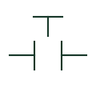

# Normally open pushbutton

A pushbutton contact normally shown open before actuation.

[Canonical reference](https://eloragrid.ai/symbols/pushbutton-no) · [Structured record](../entries/pushbutton-no.json) · [All references](README.md)

Updated: 2026-10-27. Drawing use: Schematic. Reference families: IEC, IEEE / ANSI.

## What it represents

A normally open pushbutton combines an operator-actuated mechanism with a contact shown open in its defined normal state. Momentary and maintained or latching operation are separate characteristics that must be described explicitly.
Control schematics should identify both the contact function and the operator-facing purpose. A start label is a circuit-specific use, not an intrinsic property of every NO pushbutton. Multiple contact blocks can belong to a single actuator.

## How to read it

- Read the actuator description and contact-block association.
- Check whether the operating mode is momentary, maintained or latching.

## Drawing checklist

- Identify the actuator and contact terminals.
- State the intended operating mode.
- Link additional contact blocks to the same operator device.

## Important distinction

A NO contact symbol by itself does not identify the pushbutton actuator or its mechanical operating mode.

## Facts

- Normal contact state: Open
- Operating mode: Momentary or maintained; specify explicitly
- Actuator purpose: Circuit-specific label
- Public Autodesk reference names: HPB11, VPB11 (vendor identifiers, not IEC symbol IDs)

## Public references

- [Pushbutton contact and actuator variants](https://help.autodesk.com/cloudhelp/2021/ENU/AutoCAD-Electrical/files/GUID-9E8890C7-7176-47DD-8700-E02A16C1670E.htm) — Autodesk. Public NO pushbutton and operating-mode variants.

## Related references

- [Normally closed pushbutton](pushbutton-nc.md)
- [Normally open contact](normally-open-contact.md)
- [Selector switch](selector-switch.md)
- [Relay coil](relay-coil.md)

Original educational concept geometry, CC BY 4.0. Unitless; not a certified standards glyph or manufacturer footprint.

Elora-authored explanations are CC BY 4.0. Linked standards and manufacturer material retain their own rights. Confirm project requirements using primary sources.
