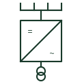

# PV central inverter

A large solar inverter fed from DC combiner boxes, usually paired with its own medium-voltage transformer.

[Canonical reference](https://eloragrid.ai/symbols/pv-central-inverter) · [Structured record](../entries/pv-central-inverter.json) · [All references](README.md)

Updated: 2026-10-28. Drawing use: SLD. Reference families: IEC, IEEE / ANSI.

## What it represents

A central inverter converts the combined output of many PV strings at a single location. Strings are first paralleled in DC combiner boxes, which feed DC recombiners and then the inverter. Ratings run from several hundred kilowatts to several megawatts, and the inverter usually sits in a skid with a medium-voltage step-up transformer and switchgear.
Single-line diagrams show the DC combiner network converging on one inverter block, the inverter output to a low-voltage winding of the skid transformer, and the medium-voltage ring main unit. Dual inverters sharing one three-winding transformer are also common.
A central inverter fault takes a large part of the plant offline, and the DC cabling distances are long. The symbol does not show DC earthing arrangement or insulation monitoring, which differ between plants and must be stated separately.

## How to read it

- Trace DC combiner and recombiner levels back to the strings.
- Check whether two inverters share one transformer.

## Drawing checklist

- State inverter rating and DC voltage range.
- Show combiner hierarchy and skid transformer.
- Reference DC earthing and insulation monitoring.

## Important distinction

A central inverter collects many combined strings; a string inverter connects a few strings directly.

## Facts

- DC inputs: From combiner boxes
- Typical rating: Hundreds of kW to several MW
- Packaging: Skid with MV transformer
- Preview: Independent educational illustration; consult the applicable standard and project legend for the exact graphic

## Public references

- [Photovoltaic technology and inverter functions](https://www.electrical-installation.org/enwiki/Photovoltaic_background%2C_technology) — Schneider Electric. Public photovoltaic inverter function context.
- [Solar string combiner functions](https://www.ti.com/solution/smart-combiner-box) — Texas Instruments. Public solar string combiner function context.

## Related references

- [Photovoltaic string combiner](photovoltaic-string-combiner.md)
- [PV string inverter](pv-string-inverter.md)
- [Photovoltaic inverter](photovoltaic-inverter.md)
- [PV inverter cabinet](ga-pv-inverter-cabinet.md)

Original educational concept geometry, CC BY 4.0. Unitless; not a certified standards glyph or manufacturer footprint.

Elora-authored explanations are CC BY 4.0. Linked standards and manufacturer material retain their own rights. Confirm project requirements using primary sources.
