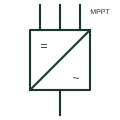

# PV string inverter

A solar inverter connecting a small number of PV strings directly, each group tracked by its own MPPT input.

[Canonical reference](https://eloragrid.ai/symbols/pv-string-inverter) · [Structured record](../entries/pv-string-inverter.json) · [All references](README.md)

Updated: 2026-10-28. Drawing use: SLD. Reference families: IEC, IEEE / ANSI.

## What it represents

A string inverter connects one or a few PV strings directly to its DC inputs, usually with two or more independent maximum power point trackers. In commercial and utility plants many string inverters are spread across the array and their AC outputs are collected at an AC combiner board.
Single-line diagrams show the inverter box with several DC inputs, each labelled by MPPT and string count, plus a DC isolator and sometimes string fuses inside the inverter. The AC side shows the output breaker and the combiner or distribution board.
The symbol does not tell you whether strings on the same tracker share orientation, which affects yield, nor whether the inverter has integrated arc fault detection. The string configuration schedule carries that detail.

## How to read it

- Count MPPT inputs and the strings on each.
- Check for DC isolators on each input.

## Drawing checklist

- State number of MPPTs and strings per MPPT.
- Show DC isolation and AC protection.
- Reference string configuration schedule.

## Important distinction

A string inverter serves a few strings near the array; a central inverter collects many combined strings at one large unit.

## Facts

- DC inputs: A few strings, multiple MPPTs
- Typical rating: A few kW to a few hundred kW
- AC collection: AC combiner board
- Preview: Independent educational illustration; consult the applicable standard and project legend for the exact graphic

## Public references

- [Photovoltaic technology and inverter functions](https://www.electrical-installation.org/enwiki/Photovoltaic_background%2C_technology) — Schneider Electric. Public photovoltaic inverter function context.
- [Solar electrical system architecture](https://www.ti.com/applications/industrial/energy-infrastructure/solar-energy/overview.html) — Texas Instruments. Public solar electrical system architecture context.

## Related references

- [Photovoltaic inverter](photovoltaic-inverter.md)
- [Photovoltaic string](photovoltaic-string.md)
- [PV central inverter](pv-central-inverter.md)
- [PV microinverter](pv-microinverter.md)

Original educational concept geometry, CC BY 4.0. Unitless; not a certified standards glyph or manufacturer footprint.

Elora-authored explanations are CC BY 4.0. Linked standards and manufacturer material retain their own rights. Confirm project requirements using primary sources.
