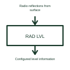

# Radar level sensing function

A radar sensing function uses radio-frequency signals to obtain information about a target or surface.

[Canonical reference](https://eloragrid.ai/symbols/radar-level-sensor) · [Structured record](../entries/radar-level-sensor.json) · [All references](README.md)

Updated: 2026-10-27. Drawing use: Schematic. Reference families: Manufacturer.

## What it represents

A radar sensing function uses radio-frequency signals to obtain information about a target or surface.
A suitable level installation can interpret reflections from the measured surface.
Show the sensor’s radio-frequency path towards the measured surface and identify the reported level reference. A distance to the surface and a level within a vessel are related through the selected geometry. They should not be treated as identical values without defining the reference points. This is original functional artwork, not a certified standard graphic or device pinout.

## How to read it

- Identify the measured surface and level reference.
- Reference the selected sensor and installation geometry.
- Show the electrical output and receiving control system.
- The sensing principle does not establish suitability for every vessel, material or installation.

## Drawing checklist

- Identify the measured surface and level reference.
- Reference the selected sensor and installation geometry.
- Show the electrical output and receiving control system.

## Important distinction

The sensing principle does not establish suitability for every vessel, material or installation.

## Facts

- Representation type: Original functional block; not a certified IEC or IEEE graphic
- Concept input: Radio reflections from surface
- Concept output: Configured level information

## Public references

- [Radar level-transmitter architecture](https://www.ti.com/solution/level-transmitter) — Texas Instruments. Primary-source technical context for this particular function; product-specific ratings remain with the manufacturer.

## Related references

- [Temperature measuring transducer](temperature-measuring-transducer.md)
- [Hall-effect current sensor](hall-effect-current-sensor.md)
- [Magnetic position sensor](magnetic-position-sensor.md)
- [Inductive position sensor](inductive-position-sensor.md)

Original educational concept geometry, CC BY 4.0. Unitless; not a certified standards glyph or manufacturer footprint.

Elora-authored explanations are CC BY 4.0. Linked standards and manufacturer material retain their own rights. Confirm project requirements using primary sources.
