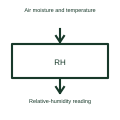

# Relative humidity sensor

A relative humidity sensor measures moisture in air relative to the saturation condition at the relevant temperature.

[Canonical reference](https://eloragrid.ai/symbols/relative-humidity-sensor) · [Structured record](../entries/relative-humidity-sensor.json) · [All references](README.md)

Updated: 2026-10-27. Drawing use: Schematic. Reference families: Manufacturer.

## What it represents

A relative humidity sensor measures moisture in air relative to the saturation condition at the relevant temperature.
A switchroom monitor can report humidity alongside temperature when assessing its environment.
Identify the air location being monitored and show temperature information where the selected interpretation needs it. Relative humidity compares water vapour with saturation at the relevant temperature. This is why the same moisture content can produce a different relative-humidity value as temperature changes. This is original functional artwork, not a certified standard graphic or device pinout.

## How to read it

- Identify the sensor’s air location and exposure.
- Distinguish humidity and temperature outputs.
- Reference the selected sensor’s mounting and response requirements.
- Relative humidity and absolute water content are different quantities.

## Drawing checklist

- Identify the sensor’s air location and exposure.
- Distinguish humidity and temperature outputs.
- Reference the selected sensor’s mounting and response requirements.

## Important distinction

Relative humidity and absolute water content are different quantities.

## Facts

- Representation type: Original functional block; not a certified IEC or IEEE graphic
- Concept input: Air moisture and temperature
- Concept output: Relative-humidity reading

## Public references

- [Humidity sensing principles](https://www.ti.com/lit/an/snaa318/snaa318.pdf) — Texas Instruments. Humidity sensing principles: public technical context for the named function. Product and compliance details remain with the publisher.

## Related references

- [Temperature measuring transducer](temperature-measuring-transducer.md)
- [Power converter / inverter](power-converter.md)
- [Terminal connection](terminal.md)

Original educational concept geometry, CC BY 4.0. Unitless; not a certified standards glyph or manufacturer footprint.

Elora-authored explanations are CC BY 4.0. Linked standards and manufacturer material retain their own rights. Confirm project requirements using primary sources.
