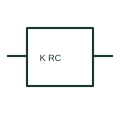

# Relay coil with RC suppression

A relay RC suppression network uses resistance and capacitance associated with the coil circuit.

[Canonical reference](https://eloragrid.ai/symbols/relay-coil-with-rc-suppression) · [Structured record](../entries/relay-coil-with-rc-suppression.json) · [All references](README.md)

Updated: 2026-10-27. Drawing use: Schematic. Reference families: IEC, Manufacturer.

## What it represents

A relay RC suppression network uses resistance and capacitance associated with the coil circuit. It provides a documented transient-control function with characteristics distinct from diode suppression.

## How to read it

- Confirm whether the RC module is internal, in the socket or separately wired.
- The preview is an original explanation of this function. Match the actual drawing convention to its legend and the selected equipment documentation.

## Drawing checklist

- Show network location
- State coil supply
- Reference compatible suppression unit

## Important distinction

RC suppression and diode suppression are not interchangeable annotations for every supply type.

## Facts

- Drawing role: Relay operation
- Representation scope: Functional concept; not an official standard graphic or a product footprint
- Public vendor block reference: HCR1K39, VCR1K39 (Autodesk identifiers; not IEC symbol numbers)
- Identifier status: The short label is a functional lookup label, not an assigned IEC or IEEE symbol number. Any separately listed Autodesk code is a verified vendor block name.

## Public references

- [AutoCAD Electrical: Relay suppression components](https://help.autodesk.com/cloudhelp/2021/ENU/AutoCAD-Electrical/files/GUID-AF7C83A4-33F4-4144-94BE-4C5F2F448FB8.htm) — Autodesk. Public documentation of this equipment function or named vendor variant; the illustration is independently authored and is not the source graphic.
- [Relays and contacts: public symbol reference](https://help.autodesk.com/cloudhelp/2021/ENU/AutoCAD-Electrical/files/GUID-011C62B8-9EC8-485C-B47D-B22A3F7B7574.htm) — Autodesk. Public documentation of this equipment function or named vendor variant; the illustration is independently authored and is not the source graphic.

## Related references

- [Relay coil](relay-coil.md)
- [Normally open contact](normally-open-contact.md)

Original educational concept geometry, CC BY 4.0. Unitless; not a certified standards glyph or manufacturer footprint.

Elora-authored explanations are CC BY 4.0. Linked standards and manufacturer material retain their own rights. Confirm project requirements using primary sources.
