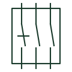

# Relay test block

Multi-pole test facility between CT, VT and trip wiring and a relay, allowing safe isolation and test injection.

[Canonical reference](https://eloragrid.ai/symbols/relay-test-block) · [Structured record](../entries/relay-test-block.json) · [All references](README.md)

Updated: 2026-10-28. Drawing use: Schematic. Reference families: IEC, Manufacturer.

## What it represents

A relay test block sits in the secondary wiring between CTs, VTs, trip outputs and a protection relay. Inserting a test plug or opening the block isolates the relay from the plant, automatically shorts CT circuits before they are opened and isolates trip outputs, so the relay can be tested with secondary injection while the primary circuit stays in service.
The schematic should show the order in which poles break and make, because CT shorting must occur before CT circuits open. The symbol alone does not show that sequence, so the terminal arrangement of each pole needs to be drawn or referenced to the manufacturer data.

## How to read it

- Check CT poles short before they open.
- Confirm trip outputs are isolated when the block is opened.

## Drawing checklist

- Number each pole
- Show CT shorting arrangement
- Show trip isolation poles

## Important distinction

A relay test block isolates and shorts circuits in one operation; a single CT test terminal handles only one conductor.

## Facts

- Isolates: CT, VT and trip circuits
- Key feature: CT shorting before opening
- Preview: Functional illustration of the device role; not a product footprint or certified standard graphic

## Public references

- [Transformer terminals for measuring and test circuits](https://www.phoenixcontact.com/en-ie/products/terminal-blocks/transformer-terminal-blocks?p=7) — Phoenix Contact. Public manufacturer range of transformer and test terminals for measuring and protection circuits.
- [Disconnect and knife-disconnect terminal blocks](https://www.phoenixcontact.com/en-au/products/terminal-blocks/disconnect-and-knife-disconnect-terminal-blocks) — Phoenix Contact. Public disconnect and test terminal families used in secondary circuits.

## Related references

- [CT test terminal](ct-test-terminal.md)
- [Test plug](test-plug.md)
- [Current test switch with shorting contact](current-test-switch-with-shorting.md)

Original educational concept geometry, CC BY 4.0. Unitless; not a certified standards glyph or manufacturer footprint.

Elora-authored explanations are CC BY 4.0. Linked standards and manufacturer material retain their own rights. Confirm project requirements using primary sources.
