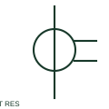

# Residual connection of phase CTs

A residual CT connection combines secondary currents from phase CTs to obtain a residual-current input.

[Canonical reference](https://eloragrid.ai/symbols/residual-connection-of-phase-cts) · [Structured record](../entries/residual-connection-of-phase-cts.json) · [All references](README.md)

Updated: 2026-10-27. Drawing use: SLD, Schematic. Reference families: IEC, Manufacturer.

## What it represents

A residual CT connection combines secondary currents from phase CTs to obtain a residual-current input. This is a connection arrangement that should be drawn explicitly rather than assigned an unsupported separate standard-symbol number.

## How to read it

- Match secondary polarity and CT characteristics across the connected phases.
- The preview is an original explanation of this function. Match the actual drawing convention to its legend and the selected equipment documentation.

## Drawing checklist

- Show each phase CT
- Identify residual summation node
- Link earth-fault relay input

## Important distinction

Residual connection of three phase CTs is not the same physical sensor as a core-balance CT.

## Facts

- Drawing role: Current measurement
- Representation scope: Functional concept; not an official standard graphic or a product footprint
- Identifier status: The short label is a functional lookup label, not an assigned IEC or IEEE symbol number. Any separately listed Autodesk code is a verified vendor block name.

## Public references

- [Current transformer symbol variants](https://help.autodesk.com/cloudhelp/2021/ENU/AutoCAD-Electrical/files/GUID-40AAEF4A-AC3F-4B3D-90A5-A9E0707C1241.htm) — Autodesk. Public documentation of this equipment function or named vendor variant; the illustration is independently authored and is not the source graphic.
- [Indoor current and voltage transformers](https://www.abb.com/gb/en/areas/electrification/medium-voltage/grid-components/core-components/indoor-instrument-transformers) — ABB. Public documentation of this equipment function or named vendor variant; the illustration is independently authored and is not the source graphic.
- [Residual current and neutral-earthing protection context](https://new.abb.com/medium-voltage/digital-substations/campaigns/earth-fault-protection-portfolio/earth-fault-offering) — ABB. Public documentation of this equipment function or named vendor variant; the illustration is independently authored and is not the source graphic.

## Related references

- [Current transformer](current-transformer.md)
- [CT test terminal](ct-test-terminal.md)

Original educational concept geometry, CC BY 4.0. Unitless; not a certified standards glyph or manufacturer footprint.

Elora-authored explanations are CC BY 4.0. Linked standards and manufacturer material retain their own rights. Confirm project requirements using primary sources.
