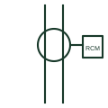

# Residual current monitor

Device with a toroid that measures residual current and gives a warning or signal without interrupting the circuit itself.

[Canonical reference](https://eloragrid.ai/symbols/residual-current-monitor) · [Structured record](../entries/residual-current-monitor.json) · [All references](README.md)

Updated: 2026-10-28. Drawing use: SLD, Schematic. Reference families: IEC, Manufacturer.

## What it represents

A residual current monitor measures residual current with a summation toroid around the circuit conductors and signals when it exceeds a threshold. It is used where an unexpected trip would be unacceptable but rising leakage still needs attention, for example in data centres and process plant.
An RCM does not disconnect the circuit by itself, so it is not a substitute for an RCD where automatic disconnection is required. The symbol shows the toroid and monitor, but the reader must find out whether its output drives an alarm only or a separate switching device.

## How to read it

- Check whether the output alarms or trips another device.
- Confirm that all live conductors, including neutral, pass through the toroid.

## Drawing checklist

- Show toroid and conductors
- State threshold
- Reference alarm or trip output

## Important distinction

An RCM signals residual current; an RCD measures it and also disconnects the circuit.

## Facts

- Sensing: Summation toroid around live conductors
- Action: Signal or alarm, no integral disconnection
- Preview: Functional illustration of the device role; not a product footprint or certified standard graphic

## Public references

- [Residual current device categories](https://www.se.com/au/en/faqs/FAQ000218859/) — Schneider Electric. Public residual current device categories for comparison with monitoring devices.
- [Residual current and neutral-earthing protection context](https://new.abb.com/medium-voltage/digital-substations/campaigns/earth-fault-protection-portfolio/earth-fault-offering) — ABB. Public context for residual current measurement.

## Related references

- [Core-balance current transformer](core-balance-current-transformer.md)
- [Earth-fault current relay](earth-fault-current-relay.md)
- [Insulation monitoring relay](insulation-monitoring-relay.md)

Original educational concept geometry, CC BY 4.0. Unitless; not a certified standards glyph or manufacturer footprint.

Elora-authored explanations are CC BY 4.0. Linked standards and manufacturer material retain their own rights. Confirm project requirements using primary sources.
