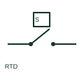

# Resistance temperature detector

An RTD is a temperature sensor whose resistance changes with temperature.

[Canonical reference](https://eloragrid.ai/symbols/resistance-temperature-detector) · [Structured record](../entries/resistance-temperature-detector.json) · [All references](README.md)

Updated: 2026-10-27. Drawing use: Schematic. Reference families: IEC, Manufacturer.

## What it represents

An RTD is a temperature sensor whose resistance changes with temperature. Its schematic needs the selected sensor characteristic and two-, three- or four-wire measurement connection.

## How to read it

- Count sensor conductors at the measuring input instead of inferring them from the sensor name.
- The preview is an original explanation of this function. Match the actual drawing convention to its legend and the selected equipment documentation.

## Drawing checklist

- State sensor characteristic
- Show conductor count
- Reference compatible temperature input

## Important distinction

An RTD is different from a discrete temperature switch or a thermocouple voltage source.

## Facts

- Drawing role: Actuated indication
- Representation scope: Functional concept; not an official standard graphic or a product footprint
- Identifier status: The short label is a functional lookup label, not an assigned IEC or IEEE symbol number. Any separately listed Autodesk code is a verified vendor block name.

## Public references

- [RTD and thermocouple temperature transducer inputs](https://www.phoenixcontact.com/en-gb/products/temperature-measuring-transducer-macx-mcr-1ts-i-olp-1145192?type=pdf) — Phoenix Contact. Public documentation of this equipment function or named vendor variant; the illustration is independently authored and is not the source graphic.

## Related references

- [PLC input / output](plc-io.md)
- [Normally open contact](normally-open-contact.md)

Original educational concept geometry, CC BY 4.0. Unitless; not a certified standards glyph or manufacturer footprint.

Elora-authored explanations are CC BY 4.0. Linked standards and manufacturer material retain their own rights. Confirm project requirements using primary sources.
