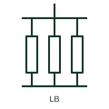

# Resistive load bank

A bank of switched resistive elements used to apply a controllable test load to generators, UPS or battery systems.

[Canonical reference](https://eloragrid.ai/symbols/resistive-load-bank) · [Structured record](../entries/resistive-load-bank.json) · [All references](README.md)

Updated: 2026-10-28. Drawing use: SLD. Reference families: IEC, IEEE / ANSI.

## What it represents

A resistive load bank is a set of resistor elements, switched in steps and cooled by fans, used to load a generator, UPS or battery system for commissioning and maintenance tests. Permanent load banks are also installed to keep diesel engines above minimum load when site demand is low.
Drawings show a resistor symbol or a group of resistors with step switches, connected through a breaker to the bus being tested. Permanently installed banks have a control link to the genset or microgrid controller, while portable banks connect through a temporary test connection point.
A resistive bank loads at unity power factor only, so it does not test a generator at its rated kVA when the rated power factor is below one. The symbol does not show step sizes or fan supply, both needed for test planning.

## How to read it

- A purely resistive bank tests kW, not kVA.
- Look for a dedicated test connection point.

## Drawing checklist

- State kW rating and step sizes.
- Show breaker and fan supply.
- Reference control interface.

## Important distinction

A resistive load bank applies only active load; a resistive-reactive bank can also apply lagging kvar.

## Facts

- Load type: Resistive, unity power factor
- Control: Switched steps
- Typical use: Generator and UPS testing
- Preview: Independent educational illustration; consult the applicable standard and project legend for the exact graphic

## Public references

- [T-030 liquid-cooled generator set application manual](https://www.cummins.com/sites/default/files/2024-08/t030-Liquid-cooled-gen-set-application-manual.pdf) — Cummins. Public generator application manual context for testing and minimum load.
- [Resistors and heater-element symbols](https://help.autodesk.com/cloudhelp/2021/ENU/AutoCAD-Electrical/files/GUID-1D071951-D38E-4B15-8B9E-C30ECBD55C19.htm) — Autodesk. Public resistor symbol family context.

## Related references

- [Resistive-reactive load bank](resistive-reactive-load-bank.md)
- [Diesel generator set](diesel-generator-set.md)
- [Resistor](resistor.md)
- [Generic electrical load](generic-electrical-load.md)

Original educational concept geometry, CC BY 4.0. Unitless; not a certified standards glyph or manufacturer footprint.

Elora-authored explanations are CC BY 4.0. Linked standards and manufacturer material retain their own rights. Confirm project requirements using primary sources.
