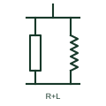

# Resistive-reactive load bank

A test load bank combining resistive and inductive steps to load a generator at its rated power factor.

[Canonical reference](https://eloragrid.ai/symbols/resistive-reactive-load-bank) · [Structured record](../entries/resistive-reactive-load-bank.json) · [All references](README.md)

Updated: 2026-10-28. Drawing use: SLD. Reference families: IEC, IEEE / ANSI.

## What it represents

A resistive-reactive load bank adds inductive reactor steps to resistive elements so that a generator can be tested at its full rated kVA and rated power factor, typically 0.8 lagging. This exercises the alternator excitation, voltage regulator and transformer heating in a way a resistive bank cannot.
Drawings show resistor and reactor groups in parallel, each with step switching, connected through a breaker. The power factor range and the kW and kvar totals are written beside the symbol.
Reactive load banks are heavier and more costly, so they are mainly used for commissioning large sets and paralleling tests. The symbol does not show the switching sequence or the instrumentation used to record test results.

## How to read it

- Read both kW and kvar ratings.
- Check that power factor range matches the generator rating.

## Drawing checklist

- State kW, kvar and power factor range.
- Show resistor and reactor steps.
- Reference test procedure.

## Important distinction

A resistive-reactive bank tests at rated kVA and power factor; a resistive bank tests at unity power factor only.

## Facts

- Load type: Resistive and inductive
- Typical test power factor: 0.8 lagging
- Use: Full kVA commissioning tests
- Preview: Independent educational illustration; consult the applicable standard and project legend for the exact graphic

## Public references

- [T-030 liquid-cooled generator set application manual](https://www.cummins.com/sites/default/files/2024-08/t030-Liquid-cooled-gen-set-application-manual.pdf) — Cummins. Public generator application context for testing.
- [AutoCAD Electrical: Reactors and inductors](https://help.autodesk.com/cloudhelp/2021/ENU/AutoCAD-Electrical/files/GUID-BAD50DBF-0951-44A0-BB4C-A57B4A4ED895.htm) — Autodesk. Public reactor symbol family context.

## Related references

- [Resistive load bank](resistive-load-bank.md)
- [Diesel generator set](diesel-generator-set.md)
- [Reactor](reactor.md)

Original educational concept geometry, CC BY 4.0. Unitless; not a certified standards glyph or manufacturer footprint.

Elora-authored explanations are CC BY 4.0. Linked standards and manufacturer material retain their own rights. Confirm project requirements using primary sources.
