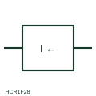

# Reverse-current measuring relay

Measuring relay that operates when current flows in the opposite direction to normal, such as back-feed into a DC source.

[Canonical reference](https://eloragrid.ai/symbols/reverse-current-relay) · [Structured record](../entries/reverse-current-relay.json) · [All references](README.md)

Updated: 2026-10-28. Drawing use: Schematic, SLD. Reference families: IEC, Manufacturer.

## What it represents

A reverse-current relay compares the direction of current with a reference and operates when current flows the wrong way. Classic uses are DC generators and battery chargers in parallel, where a failed source would otherwise draw current from the bus, and rectifier feeders where back-feed indicates a fault.
On the schematic the relay box carries a current quantity with a direction qualifier, and its contacts are drawn elsewhere in the trip or alarm circuit. The box does not show the pick-up level or time delay, and in AC systems the equivalent requirement is usually met with a directional power function rather than a simple current-direction element.

## How to read it

- Identify which direction is treated as normal for the source.
- Find the contacts that trip or disconnect the source.

## Drawing checklist

- State normal current direction
- Give pick-up and delay
- Reference the trip contact

## Important distinction

A reverse-current relay responds to current direction; a maximum-current relay responds to magnitude regardless of direction.

## Facts

- Measured quantity: Current direction relative to normal flow
- Publisher reference token: HCR1F28 (Autodesk identifier; not an IEC database ID)
- Preview: Independent educational concept; consult the publisher and applicable standard for the exact graphic

## Public references

- [AutoCAD Electrical: Current monitoring relays](https://help.autodesk.com/cloudhelp/2021/ENU/AutoCAD-Electrical/files/GUID-E0DDA638-4664-4F1E-B191-29A4C40C4A0A.htm) — Autodesk. Public AutoCAD Electrical relay listing that names the Come Back Current Protection block; the illustration is independently drawn.
- [IEC graphical symbols for diagrams](https://tc3.iec.ch/tc-activity/graphical-symbols-for-diagrams/) — IEC. IEC context for graphical symbols used in diagrams; no IEC graphic is reproduced.

## Related references

- [Maximum-current monitoring relay](maximum-current-monitoring-relay.md)
- [Directional power](32-directional-power.md)
- [Directional measuring element qualifier](directional-measuring-element-qualifier.md)

Original educational concept geometry, CC BY 4.0. Unitless; not a certified standards glyph or manufacturer footprint.

Elora-authored explanations are CC BY 4.0. Linked standards and manufacturer material retain their own rights. Confirm project requirements using primary sources.
