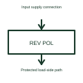

# Reverse-polarity protection controller

A reverse-polarity protection controller manages a power path against a specified reversed connection condition.

[Canonical reference](https://eloragrid.ai/symbols/reverse-polarity-protection-controller) · [Structured record](../entries/reverse-polarity-protection-controller.json) · [All references](README.md)

Updated: 2026-10-27. Drawing use: Schematic. Reference families: Manufacturer.

## What it represents

A reverse-polarity protection controller manages a power path against a specified reversed connection condition.
An input protection stage can prevent an incorrectly connected supply from reaching its load under the design conditions.
Identify the input connector, controlled switching element and protected output. This function addresses a reversed supply connection under the selected design conditions. Reverse-polarity protection must be distinguished from preventing current flowing backwards between otherwise correctly connected supplies. This is original functional artwork, not a certified standard graphic or device pinout.

## How to read it

- Identify input polarity and the protected output.
- Show the actual controlled switching element.
- Reference reversed-input and reverse-current behaviour separately.
- Reverse-polarity protection and reverse-current blocking are related but different requirements.

## Drawing checklist

- Identify input polarity and the protected output.
- Show the actual controlled switching element.
- Reference reversed-input and reverse-current behaviour separately.

## Important distinction

Reverse-polarity protection and reverse-current blocking are related but different requirements.

## Facts

- Representation type: Original functional block; not a certified IEC or IEEE graphic
- Concept input: Input supply connection
- Concept output: Protected load-side path

## Public references

- [Power-path protection and selection](https://www.ti.com/product-category/power-management/power-protection-switches-controllers/overview.html) — Texas Instruments. Power-path protection and selection: public technical context for the named function. Product and compliance details remain with the publisher.

## Related references

- [Hot-swap controller](hot-swap-controller.md)
- [Power-source multiplexer](power-source-multiplexer.md)
- [Power converter / inverter](power-converter.md)
- [Terminal connection](terminal.md)

Original educational concept geometry, CC BY 4.0. Unitless; not a certified standards glyph or manufacturer footprint.

Elora-authored explanations are CC BY 4.0. Linked standards and manufacturer material retain their own rights. Confirm project requirements using primary sources.
