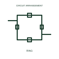

# Ring-bus circuit arrangement

Connects circuit takeoffs between adjacent switching devices in the documented bus ring.

[Canonical reference](https://eloragrid.ai/symbols/ring-bus-circuit-arrangement) · [Structured record](../entries/ring-bus-circuit-arrangement.json) · [All references](README.md)

Updated: 2026-11-03. Drawing use: SLD, Schematic. Reference families: Manufacturer.

Representation: circuit-arrangement; installation focus: switchyards.
Ring switching sections
Circuit ring connections

## What it represents

Connects circuit takeoffs between adjacent switching devices in the documented bus ring. A busbar arrangement defines the available paths between incoming circuits, outgoing circuits and bus sections. Its switching devices and measurement boundaries determine how a circuit can remain connected when part of the installation is unavailable.
In a switchyard, a single-line arrangement helps identify the bay connections, tie devices and possible alternate supply paths. Normal open points must remain separate from the equipment's physical ability to close. For this reference, the drawing identifies “Ring switching sections” at the input and “Circuit ring connections” at the output. Opening the ring changes the available supply paths.
Name each bus, bay and switching device. The arrangement illustrates electrical connectivity; reliability, fault levels, permitted switching and protection coordination require the actual network design. The circuit arrangement is an independent explanation of this named application. Equipment-specific ratings, terminal connections and operating conditions must be established in the project documentation.

## How to read it

- Start at the named input: Ring switching sections. Identify its source device or document and the state represented on the drawing.
- Follow the named output: Circuit ring connections. Cross-reference its destination and separate the command from confirmation that the equipment responded.
- Opening the ring changes the available supply paths.
- Name each bus, bay and switching device. The arrangement illustrates electrical connectivity; reliability, fault levels, permitted switching and protection coordination require the actual network design.

## Drawing checklist

- Label the source and connection reference for ring switching sections.
- Identify the destination and defined state of circuit ring connections.
- Record the equipment or control-document revision supporting this circuit arrangement.
- Check this application limit in the project design: Opening the ring changes the available supply paths.

## Important distinction

Opening the ring changes the available supply paths. This reference describes the named application; it does not establish a new IEC graphical symbol, an ANSI device-function number or an exact manufacturer connection diagram.

## Facts

- Representation: Circuit arrangement
- Installation focus: Switchyards
- Input / boundary: Ring switching sections
- Output / connection: Circuit ring connections
- Lookup label: RCA is a library lookup label, not a standard device designation.

## Public references

- [SEL-451 protection, automation and bay control](https://selinc.com/products/451/) — SEL. Public technical context for switchyard busbar arrangements. Bus arrangements, breaker control and bay-level coordination. The application text and educational graphic are independently authored; the publisher does not certify this representation.

## Related references

- [Busbar](busbar.md)
- [Disconnector](disconnector.md)
- [Mesh-corner circuit arrangement](mesh-corner-circuit-arrangement.md)

Original educational concept geometry, CC BY 4.0. Unitless; not a certified standards glyph or manufacturer footprint.

Elora-authored explanations are CC BY 4.0. Linked standards and manufacturer material retain their own rights. Confirm project requirements using primary sources.
