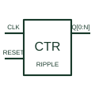

# Ripple binary counter

Counts clock events through cascaded storage stages whose output changes do not occur simultaneously.

[Canonical reference](https://eloragrid.ai/symbols/ripple-binary-counter) · [Structured record](../entries/ripple-binary-counter.json) · [All references](README.md)

Updated: 2026-10-27. Drawing use: Schematic. Reference families: Manufacturer.

## What it represents

Counts clock events through cascaded storage stages whose output changes do not occur simultaneously.
On a schematic, identify the count input, clock polarity and clear input and trace the binary outputs and any decoded control signals. Keep the component tag and signal/reference names consistent across the control drawing, terminal schedule and device documentation.
Ripple transitions can briefly expose intermediate combinations; synchronous counters have a different update arrangement.
The preview is an independently drawn educational functional reference. Add the selected component’s actual power pins, terminal numbers, timing or analogue reference details when producing a construction drawing.

## How to read it

- Identify the count input, clock polarity and clear input.
- Trace the binary outputs and any decoded control signals.

## Drawing checklist

- Label the count input, clock polarity and clear input.
- Cross-reference the binary outputs and any decoded control signals.
- Add the selected device or circuit documentation revision, power/reference connections and project signal convention.

## Important distinction

Ripple transitions can briefly expose intermediate combinations; synchronous counters have a different update arrangement.

## Facts

- Common schematic mnemonic: CTR-RIP — descriptive only; project/device documentation defines reference designations.
- Terminal / interface focus: The count input, clock polarity and clear input
- Artwork scope: Original educational functional/circuit reference; not a selected product pinout.

## Public references

- [SN74HC393 — ripple binary counters](https://www.ti.com/lit/ds/symlink/sn74hc393.pdf) — Texas Instruments. Public primary manufacturer documentation establishes the component function or circuit/topology relationship. Preview geometry and drafting explanations are independently authored.

## Related references

- [Synchronous binary counter](synchronous-binary-counter.md)
- [PLC input / output](plc-io.md)

Original educational concept geometry, CC BY 4.0. Unitless; not a certified standards glyph or manufacturer footprint.

Elora-authored explanations are CC BY 4.0. Linked standards and manufacturer material retain their own rights. Confirm project requirements using primary sources.
