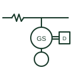

# Rotary UPS

A UPS built around a rotating synchronous machine with kinetic storage, often coupled to a diesel engine for long backup.

[Canonical reference](https://eloragrid.ai/symbols/rotary-ups) · [Structured record](../entries/rotary-ups.json) · [All references](README.md)

Updated: 2026-10-28. Drawing use: SLD. Reference families: IEC, IEEE / ANSI.

## What it represents

A rotary UPS uses a synchronous machine running continuously on the critical bus, with stored kinetic energy in a flywheel or induction coupling bridging the gap until a coupled diesel engine starts and takes over. A choke between the utility and the critical bus lets the machine condition the supply and isolate the load from network faults.
Single-line diagrams show the incoming utility feeder, a series choke, the synchronous machine with its kinetic energy module and clutch to the engine, and the critical and sometimes non-critical outputs. A bypass path around the unit is normally drawn.
The machine provides real short-circuit current, unlike a static UPS, which helps downstream protection discriminate. The symbol does not show the ride-through time to engine pickup or the choke impedance, both of which matter for design.

## How to read it

- Identify the choke between the utility and critical bus.
- Check engine coupling and the kinetic module.

## Drawing checklist

- State machine rating and ride-through time.
- Show choke, engine coupling and bypass.
- Reference fault current contribution.

## Important distinction

A rotary UPS uses rotating machines and kinetic storage; a static UPS uses power electronics and a battery.

## Facts

- Energy store: Kinetic, flywheel or induction coupling
- Long backup: Coupled diesel engine
- Fault current: Machine-sourced
- Preview: Independent educational illustration; consult the applicable standard and project legend for the exact graphic

## Public references

- [DC UPS, AC UPS and capacitor buffer modules](https://www.phoenixcontact.com/en-gb/products/uninterruptible-power-supplies-ups) — Phoenix Contact. Public UPS function context.
- [T-030 liquid-cooled generator set application manual](https://www.cummins.com/sites/default/files/2024-08/t030-Liquid-cooled-gen-set-application-manual.pdf) — Cummins. Public engine-generator application context.

## Related references

- [Flywheel energy storage](flywheel-energy-storage.md)
- [Motor-generator set](motor-generator-set.md)
- [Online double-conversion UPS](online-double-conversion-ups.md)
- [Diesel generator set](diesel-generator-set.md)

Original educational concept geometry, CC BY 4.0. Unitless; not a certified standards glyph or manufacturer footprint.

Elora-authored explanations are CC BY 4.0. Linked standards and manufacturer material retain their own rights. Confirm project requirements using primary sources.
