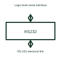

# RS-232 transceiver

An RS-232 transceiver converts between logic-level serial signals and the selected RS-232 electrical interface.

[Canonical reference](https://eloragrid.ai/symbols/rs-232-transceiver) · [Structured record](../entries/rs-232-transceiver.json) · [All references](README.md)

Updated: 2026-10-27. Drawing use: Schematic. Reference families: Manufacturer.

## What it represents

An RS-232 transceiver converts between logic-level serial signals and the selected RS-232 electrical interface.
A controller can connect to a compatible serial service port using the required conversion device.
Put logic-level serial signals on one side and RS-232 signals on the other. These are different electrical levels, even when both carry serial data. Label the transmit, receive and reference connections according to the selected devices so crossing or connector conventions are not guessed. This is original functional artwork, not a certified standard graphic or device pinout.

## How to read it

- Distinguish logic-level UART and RS-232 connections.
- Identify transmit, receive and signal-reference connections.
- Reference the exact connector and device pin assignments.
- Logic-level UART wiring is not directly interchangeable with an RS-232 electrical connection.

## Drawing checklist

- Distinguish logic-level UART and RS-232 connections.
- Identify transmit, receive and signal-reference connections.
- Reference the exact connector and device pin assignments.

## Important distinction

Logic-level UART wiring is not directly interchangeable with an RS-232 electrical connection.

## Facts

- Representation type: Original functional block; not a certified IEC or IEEE graphic
- Concept input: Logic-level serial interface
- Concept output: RS-232 electrical link

## Public references

- [RS-232 transceiver functions](https://www.ti.com/product-category/interface/rs-232-transceivers/overview.html) — Texas Instruments. RS-232 transceiver functions: public technical context for the named function. Product and compliance details remain with the publisher.

## Related references

- [Logic bus transceiver](logic-bus-transceiver.md)
- [Power converter / inverter](power-converter.md)
- [Terminal connection](terminal.md)

Original educational concept geometry, CC BY 4.0. Unitless; not a certified standards glyph or manufacturer footprint.

Elora-authored explanations are CC BY 4.0. Linked standards and manufacturer material retain their own rights. Confirm project requirements using primary sources.
